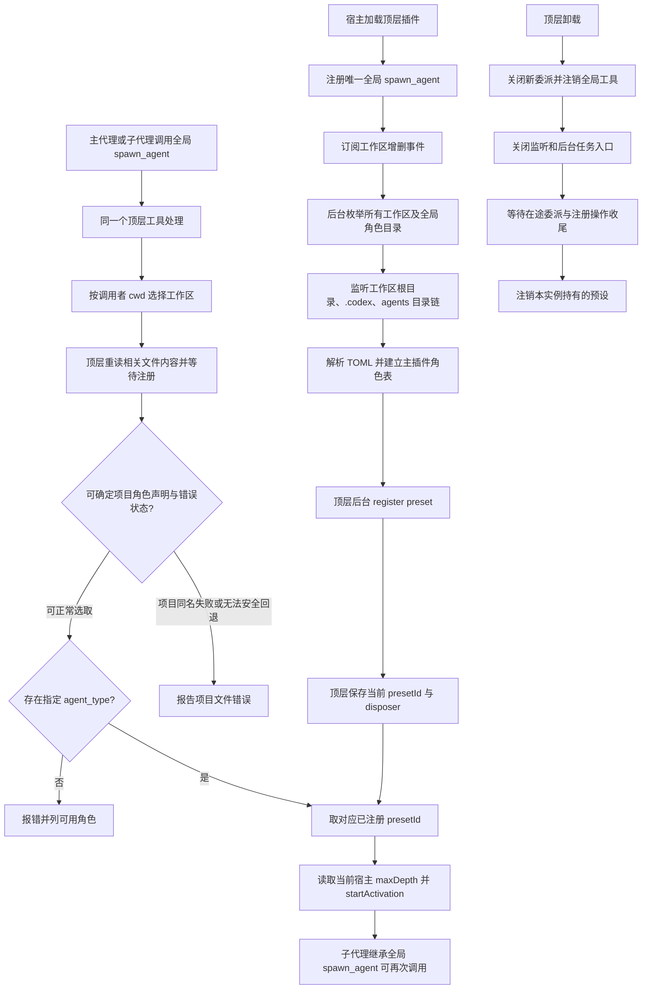

# dsh-codex-agents 执行计划

- 版本：v13
- 日期：2026-10-26
- 状态：Proposed review status: pending（v13 有正式行为修订，待独立计划审核，不由计划作者批准）
- 上一版：v12，提交 `7fcc7e72c01361c36a75f949fb5ea24a09e7f889`；v11 产品方案已获正式审核通过
- 目标仓库：`RekiDunois/dsh-codex-agents`，分支 `plan/dsh-codex-agents-plugin`
- 目标运行时：`@deepseek-ai/dsh-desktop-runtime@0.2.1-rc.3`
- 需求来源：PR #1 六项业务目标、2026-10-25 顶层预注册及隔离决定，以及验收决定人 2026-10-26 确认的同名角色失败不回退、父子目录事件恢复监听、不要求工作区删除与在途委派瞬时原子交接
- v12 历史修订：取消正式测试必须使用独立 `HOME` 的要求，产品方案不变。
- v13 修订：明确已声明的项目同名角色加载失败时禁止全局回退；同时监听根目录、`.codex` 和 `agents`，删除重建时依赖父级事件重绑且不使用轮询；取消主动删除工作区与已开始委派瞬时交错的特殊保证。

## 1. 本版核心决定

**顶层唯一管理者。** 主插件加载后立即注册唯一的全局 `spawn_agent`，从 `ctx.workspaceRegistry.list()` 获得已登记工作区，再加上单独的 `~/.codex/agents/` 全局目录；在后台异步扫描并注册角色预设。只有主插件拥有扫描、注册、替换和注销责任。

**工具注销归顶层。** 主插件保存 `ctx.tools.register` 返回的全局 `spawn_agent` 注销回调。卸载时先关闭新委派入口并撤销工具注册，待已经开始的委派临界区与后台注册收尾后，才释放角色预设；子代理不能注销该工具。宿主已经接受启动的子代理继续由宿主管理。

**子代理复用全局工具。** 预设中不加载第二份 `dsh-codex-agents`；子代理通过宿主全局工具表调用同一个 `spawn_agent`，其调用仍由顶层管理器按实际工作目录判断工作区。

**目录事件监听。** 顶层使用 `node:fs.watch` 同时监听已登记工作区根目录及其中存在的 `.codex/`、`agents/`；全局角色同理监听用户主目录及其后两级。父目录监听在子目录存在时也保留，靠上一级事件发现子目录删除、重建并重新绑定下级监听，无定时轮询。事件触发后台刷新；每次 `spawn_agent` 委派前仍读当前角色文件及内容摘要，避免遗漏事件导致旧指令被使用。

**隔离仅约束 `spawn_agent`。** 项目角色优先、跨工作区隔离和错误名单仅约束本工具；宿主原生预设列表、下拉框及独立原生预设选择不属于本次隔离范围。

**项目角色错误优先报错。** 项目已声明某个 `name`，即使其角色字段、注册、加载或更新失败，该名称仍由项目占用；同名调用报告项目角色错误，禁止自动切换到全局同名角色。仅在确认项目未声明此名称时允许全局回退。当前损坏文件若无法解析名称，优先沿用同一路径此前可信的名称；否则不得从文件名猜测，涉及无法安全判断的全局回退时须报项目文件错误。其它可以确认且正常的项目角色保持可用。

**工作区删除范围。** 正常新增和移除工作区仍由宿主事件更新监听与角色；删除登记与已经开始的委派或后台任务瞬时交错时不承诺原子交接，不新增特殊并发锁。主插件整体卸载的停止新委派、等待在途启动再注销预设的要求继续有效。

| 项目 | v10 | v11 |
|---|---|---|
| 全局工具卸载 | 规定顶层注册 `spawn_agent`，但只明确了角色预设的注销流程 | 顶层持有工具注销回调；关闭新委派、撤销工具注册并等在途操作退出后清理预设 |
| 其余决定 | 顶层预注册、全局工具、目录事件监听、调用前读实际内容、`spawn_agent` 专属隔离、固定长哈希、无磁盘索引 | 全部保持不变 |

此前已取消的 `managedChild`、跨实例 `WeakMap`、`byId` 所有权推断、编号后缀、持久索引和子代理重复加载插件，本版不恢复。历史审核评论不构成第二套实施方案。

v11 产品方案于 2026-10-25 获独立批准；v12 仅改测试环境说明。v13 只重开项目错误回退、目录事件重绑和工作区删除竞态三个决定及其直接连带影响，未受影响的旧审核结论可依据影响分析继续复用。v13 待独立计划审核，不自动沿用 v11 的最终批准。

## 2. 目标、范围与必须保持的行为

1. 在已登记工作区根目录的 `.codex/agents/*.toml` 中发现角色后，`spawn_agent(task_name, agent_type, message)` 能启动具有该 TOML 角色指令的子代理。
2. 通过 `spawn_agent` 调用时，不同项目同名角色隔离；项目已声明的同名角色始终优先，即使项目角色加载失败也不得回退到全局同名角色；确认项目没有声明的全局角色仍可调用。
3. 此工具收到未知 `agent_type` 时明确报错，列出该调用者所属工作区及全局合并名单，不静默回退；不在此工具的错误信息中暴露其它工作区独有角色。
4. 插件启动不等待目录扫描、监听初始化和预设加载，主界面不会因为同步扫描阻塞。
5. 顶层保留根目录／`.codex`／`agents` 的可用目录监听，依父目录事件恢复删除重建的子目录监听，不使用定时轮询。角色 TOML 变化触发后台异步刷新，下一次 `spawn_agent` 前仍按实际文件内容核对并使用新版指令；旧子代理继续使用旧版。
6. 角色监听、扫描、预设注册、更新、注销由顶层管理；子代理不启动第二份插件管理器。
7. 子代理拥有相同的全局 `spawn_agent`，可继续委派，每次使用 DSH 当前生效的宿主 `maxDepth`。

**范围与非目标**：

- 工作区来自宿主 `workspaceRegistry.list()`，其 `path` 是规范化绝对路径；只处理已登记工作区根目录的 `.codex/agents/` 和单独的全局 `~/.codex/agents/`。不扫描或监听未登记的其它项目。
- 子会话位于已登记工作区的子目录时仍使用该工作区角色；调用者 `cwd` 不匹配任何已登记工作区时，只能选择全局角色。取消 v8 任意父目录查找。
- 文件事件到达后在后台尽早刷新；下一次委派前按实际内容核对角色。新工作区及删除工作区通过宿主事件更新监听和注册，已删除工作区在相关任务收尾后的稳定状态清理对应来源。
- 用户主动删除工作区登记与已在进行的委派、后台扫描或注册瞬时交错，不属于本版原子一致性保证，不另增跨工作区锁和专门测试；插件整体卸载安全不受此调整影响。
- 跨工作区角色隔离只约束 `spawn_agent` 的查找和错误名单。宿主原生预设列表、预设下拉框和独立原生预设选择不在本版隔离范围内；不修改宿主原生权限或预设注册表的可见性。
- `model`、`model_reasoning_effort`、`sandbox_mode`、`mcp_servers`、`skills.config` 暂不支持；不增加额外子代理工具权限、不恢复进程重启前的子代理。
- 子代理结束与结果通知仍由 DSH 原生运行时处理；`spawn_agent` 三参数与 `delivery: 'parent'` 不变。

## 3. 决策依据与来源

### 正式要求

- [PR #1](https://github.com/RekiDunois/dsh-codex-agents/pull/1)：原有五条产品成功标准。
- 用户于 2026-10-25 确认的顶层预注册与监听、`spawn_agent` 专属隔离；2026-10-26 确认：项目同名角色失败不回退全局，用父子目录事件恢复 `.codex/agents` 删除重建且不轮询，取消工作区主动删除与在途委派瞬时原子交接保证。
- [Project Consensus](https://app.notion.com/p/3d60101a85f3815a8c43f271f2b4d91d) 与 [Plan Reviewer Rule](https://app.notion.com/p/3e80101a85f3817a94cbc6eca1a76a5c)。正式测试由 [Test Engineer Rule](https://app.notion.com/p/3d80101a85f380d8a8f5ce528141e253) 及独立测试计划负责。

### 宿主实现依据

以下源码版本统一为 `deepseek-ai/deepseek-harness@22ddee3792402c3e70ec5f86a63c3e3e895a2f60`：

| 关键决策 | 已确认的宿主事实 |
|---|---|
| 列出工作区 | [WorkspaceRegistry.list()](https://github.com/deepseek-ai/deepseek-harness/blob/22ddee3792402c3e70ec5f86a63c3e3e895a2f60/packages/workspace/workspace/src/index.ts) 同步读取已登记的规范目录 `path`；不代表所有磁盘目录 |
| 感知工作区新增、移除 | [WorkspaceFeed](https://github.com/deepseek-ai/deepseek-harness/blob/22ddee3792402c3e70ec5f86a63c3e3e895a2f60/packages/api/workspace-controller/src/feed.ts) 使用 `ctx.on('domain/changed')` 观察 `workspace` 存储域变化 |
| 全局工具供父子代理调用 | [ToolsService.register()](https://github.com/deepseek-ai/deepseek-harness/blob/22ddee3792402c3e70ec5f86a63c3e3e895a2f60/packages/core/tools/src/index.ts#L121-L152) 在未标记 agent scope 的宿主上下文注册全局工具，[工具可见性](https://github.com/deepseek-ai/deepseek-harness/blob/22ddee3792402c3e70ec5f86a63c3e3e895a2f60/packages/core/tools/src/index.ts#L191-L229) 合并全局与代理局部工具，明确限制才会隐藏 |
| 注册预设、替换和保留旧任务 | [AgentPresetRegistry](https://github.com/deepseek-ai/deepseek-harness/blob/22ddee3792402c3e70ec5f86a63c3e3e895a2f60/packages/preset/agent-preset-registry/src/index.ts#L93-L153) 的 `register` 返回 `dispose`、拒绝重复 ID；`resolve` 可报告 `broken`；卸载旧代际时保留仍在使用的版本 |
| 委派层数 | [SubagentRuntime](https://github.com/deepseek-ai/deepseek-harness/blob/22ddee3792402c3e70ec5f86a63c3e3e895a2f60/packages/subagent/subagent/src/index.ts) 的 `resolveMaxDepth()` 返回宿主当前限制；[原生工具](https://github.com/deepseek-ai/deepseek-harness/blob/22ddee3792402c3e70ec5f86a63c3e3e895a2f60/packages/subagent/tool-subagent/src/index.ts#L314-L339) 把该值写入 `startActivation` 请求 |

选择“顶层预注册 + 全局工具”是因为宿主已支持这些操作。替代方案 v8 的“子代理内加载同一插件 + 跨实例共享”和旧的“首次调用才注册”均能满足部分目标，但增加管理状态或不符合用户新增的预注册要求。启动时后台注册会消耗时间和内存，使用限并发及逐批让出事件循环控制。

**文件监听的已知行为**：[Node.js 24 文件系统文档](https://nodejs.org/download/release/v24.17.0/docs/api/fs.html) 说明 `fs.watch` 可监听目录 `change` 和 `rename`，事件文件名可能缺失；目录删除重建后旧监听可能仍绑定旧文件节点，有些文件系统也可能漏报。采取“各级父目录保留监听、变化事件驱动下级重绑、每次委派前重读实际文件”，不用定时轮询。根目录监听 `.codex` 变化，`.codex` 监听 `agents` 变化，`agents` 监听角色文件变化；事件漏报仍由调用前内容摘要检查保障。

## 4. 业务流与状态归属



**状态与职责**：

- 宿主 `workspaceRegistry` 管理工作区的登记、路径及变更通知。
- 仅顶层 `manager.ts` 管理目录扫描、角色数据、注册任务、固定编号和预设注销回调；它持有的 `watch.ts` 负责监听、重新绑定和退出清理。
- 顶层 `index.ts` 还拥有唯一全局 `spawn_agent` 的注册与注销回调，负责先关闭工具接入、撤销其工具注册，再协调管理器完成退出清理。
- 宿主 `agentPresets` 管理预设及其运行中旧版本。
- 宿主 `subagents` 负责启动、生命周期、深度限制和父子消息。
- 子代理只作为全局工具调用者；不存在子插件管理器，也没有跨插件实例共享对象。

## 5. 交付文件、包配置与安装

```text
dsh-codex-agents/
├── package.json
├── cordis.patch.yml
├── tsconfig.json
├── locale/en.json
├── locale/zh.json
├── icon.svg
├── src/
│   ├── index.ts          顶层加载、服务声明、全局工具和生命周期
│   ├── workspaces.ts     已登记工作区列表、当前会话归属、变更事件
│   ├── watch.ts          文件目录监听、事件合并、路径重绑与清理
│   ├── toml.ts           TOML 解析、字段与名称校验
│   ├── roster.ts         项目与全局角色合并
│   ├── preset.ts         预设内容、确定性 ID、注册及替换
│   ├── base-plugins.ts   子代理基础工具，不包含本插件
│   ├── manager.ts        唯一顶层角色表与后台队列
│   └── tool.ts           唯一全局 spawn_agent 定义与派发
├── lib/                  发布的 ESM 及声明产物
└── test/                 生产模块必要的单元测试
```

取消 `src/index-cache.ts`、旧 `discover.ts` 的任意父目录搜索以及 `.dsh/agents-index.json`。不为本功能写额外通用持久状态程序。

保留 v8 的发布约定：

- `package.json`：`name=dsh-codex-agents`、`type=module`、`main=./lib/index.js`、`types=./lib/index.d.ts`、`exports["."]` 对应同一对产物；`files` 包含 `lib/**/*.js`、`lib/**/*.d.ts`、`cordis.patch.yml`、`locale/*.json`、`icon.svg` 及说明文件；`dsh.bundle.patch=./cordis.patch.yml`。
- 普通 `dependencies` 包含运行期 `@deepseek-ai/schemastery@3.18.5`、`smol-toml@^1.9.1`。
- `peerDependencies` 使用宿主实例：`@deepseek-ai/cordis >=4.0.5 <5`，`@deepseek-ai/dsh-tools`、`@deepseek-ai/dsh-subagent`、`@deepseek-ai/dsh-agent-preset-registry`、新增 `@deepseek-ai/dsh-workspace` 和 `@deepseek-ai/dsh-storage-domain` 均按目标宿主版本 `>=0.2.1-rc.3 <0.3.0`；`devDependencies` 锁定对应目标包版本，并提供 `typescript` 与 `@types/node`。
- `tsconfig.json` 一份：`target=ES2023`、`module=NodeNext`、`moduleResolution=NodeNext`、`rootDir=src`、`outDir=lib`、`declaration=true`、`strict=true`、`noEmitOnError=true`。
- `npm run build` 生成 `lib/index.js` 和 `lib/index.d.ts`，`npm run typecheck` 不写产物，`prepack` 负责打包前构建。安装采用正式 `dsh plugin add`，不使用开发路径、手改消费者或复制产物。
- `Config` 由 `schemastery` 定义最小有效配置，工具名固定 `spawn_agent`，provider 固定 `spawn`，目录固定 `.codex/agents`。移除插件级 `maxDepth`、`indexFileName`、`searchParents`、`maxParentDepth`、冲突后缀等配置。

## 6. 顶层插件加载与工作区扫描

### 6.1 顶层入口

`src/index.ts` 必须声明：

```ts
export const name = 'dsh-codex-agents'
export const inject = ['tools', 'subagents', 'agentPresets', 'workspaceRegistry']
export const Config = /* schemastery 最小配置 */

export function apply(ctx, config) {
  // 构造唯一主插件 manager
  // 通过 ctx.tools.register 注册全局 spawn_agent，并保存返回的 unregister 回调
  // 顶层统一管理工具注销、工作区订阅、监听与预设清理；子预设不持有回调
  // apply 返回后才调度后台扫描；不 await 全部注册
}
```

`inject` 保证四个服务可用。顶层工具注册发生在没有代理作用域的主插件中，不允许在子代理局部重复注册。`ctx.tools.register` 在调用方上下文的 `effect` 中保存撤销动作，并返回该次注册专属的注销函数（[宿主源码](https://github.com/deepseek-ai/deepseek-harness/blob/22ddee3792402c3e70ec5f86a63c3e3e895a2f60/packages/core/tools/src/index.ts#L121-L153)）；`index.ts` 持有此返回函数，卸载时只撤销本次注册，不按工具名删除其它插件定义，不另建第二份工具注册。宿主自动效果清理和显式卸载的重叠路径须幂等。`apply` 不逐目录读文件、不同步注册预设；使用后续事件循环任务运行扫描队列，避免自身激活尚未完成时等待预设插件树。

### 6.2 首次后台预注册

1. 取得 `ctx.workspaceRegistry.list()` 的所有规范化工作区 `path`，另从进程 `HOME` 定位 `~/.codex/agents/`。没有目录视为空，不创建、不扫描用户无关目录。
2. 主管理器先对工作区根目录和用户主目录设置监听，并在现有的 `.codex/`、`agents/` 上保留并行监听；不存在的子目录由父级事件发现后补绑，再异步列举 `agents/*.toml` 解析注册。初扫及后续事件共用刷新队列。
3. 将当前角色送入同一个限制并发数量的后台注册队列，按小批处理并主动让出事件循环。`register` 会加载完整的预设插件树，所以不允许无界并发预注册。
4. 每个角色只发布完成 `register` 且经过 `resolve` 诊断为可用的 `presetId`。单个错误文件或预设只影响自身。
5. 如果工具调用先于该角色扫描结束，主管理器等待或优先处理该角色/目录的后台任务，不能把“还在加载”误报成未知角色。

### 6.3 工作区增删

- 在主插件中监听 `ctx.on('domain/changed', ...)`；只对 `domain === 'workspace'` 的登记变化安排一次合并更新，再读 `workspaceRegistry.list()` 得到权威目录列表，不自己解释历史工作区数据。
- 新增工作区：安装其角色目录监听，后台扫描并注册；删除工作区：关闭对应监听，将其角色移出名单并注销顶层持有的预设，保留其它工作区与全局角色。
- 正常删除工作区登记后按宿主事件移除相关监听和预设；在旧在途任务结束后的稳定状态不再将该工作区作为角色来源。工作区主动删除与正在进行的委派、后台注册瞬时交错不承诺原子处理，不新增路径代际锁或专门测试；运行中旧子代理由宿主管理。

### 6.4 角色文件变化与目录监听

- `src/watch.ts` 在顶层同时监听已登记工作区的根目录、存在的 `.codex/` 和 `agents/`，全局角色同理监听用户主目录及后两层，均使用 `node:fs.watch`，不逐文件监听。根目录事件用于发现 `.codex` 创建或删除，`.codex` 事件用于发现 `agents` 变化，`agents` 事件用于发现角色文件变化；事件含 `change`、`rename` 或缺失文件名时标脏相应目录链，合并短时间事件并通知 `manager.ts` 异步刷新。
- 子目录不存在时不创建用户目录，保留最上层仍存在的父目录监听；下级目录出现时添加监听并继续保留父级监听。目录删除、重命名、原子替换或监听失效后关闭受影响的旧监听并通过父目录事件重绑，即使路径字符串完全相同也不能沿用旧文件节点。`.codex` 整体删除重建仍由工作区根目录或用户主目录事件恢复。只监听已登记工作区自身根目录以下及全局角色对应路径，不轮询、也不递归监听无关项目。
- **每次 `spawn_agent` 调用前**，顶层针对调用者所属工作区及全局角色目录，重新列举当前 `*.toml`，读取实际文件内容并计算摘要（例如 SHA-256），与已注册记录比较，检查新增、删除、修改与同名冲突；不依赖事件是否送达，也不以 `mtimeMs` 或 `size` 相等证明文件未变。等待相关更新完成后再选角色并提交委派；不重新扫描其它工作区。
- 监听出错、文件名缺失或目录原子替换时从保留的父级重新确认下级监听；监听暂不可用时调用前读取仍保障正确内容。目录确实不存在可视为空；目录读取、文件权限、解析、注册和加载失败应保留路径与实际原因并报告给相关调用，不得当成项目不存在同名角色而全局回退。
- 后台事件处理、调用前校验及同一 `RoleKey` 的角色文件替换仍使用串行流程；主插件整体卸载后旧事件与后台任务不得重新注册。已删除工作区在旧在途任务结束后的稳定状态应被清理；不额外约束删除登记与在途委派同时发生的瞬时原子交接。子代理不单独监听或扫描。

## 7. 角色解析、预设编号与更新

### 7.1 TOML 与名单

`smol-toml` 解析 `name`、`description`、`developer_instructions`；`name` 必须满足 `^[A-Za-z0-9_-]+$` 且不得从文件名推断。解析得出名称但其它字段、注册或加载失败时，保留该项目名称占用和文件错误；当前文件损坏到无法确认名称时，允许沿用同一路径以前成功解析的名称。首次出现即无法确认名称时，不猜测名字；当它可能影响全局回退的正确性时报告该项目文件错误并拒绝回退。其它正常且可确定的项目角色继续可用，本版未支持字段仍忽略。

`roster.ts` 以 `name` 合并当前项目与全局角色：项目已声明名称优先于全局，即使其预设不可用也必须保留名称占用；相关调用报项目文件与原因，禁止全局同名补位。只有确认项目没有声明该名称且没有无法判定名称的错误文件，才允许全局回退。未知角色名单仍按实际可用名称排序。同目录两个文件声明相同名称继续标记冲突并隐藏，不回退全局。

### 7.2 单份内存状态与简单编号

唯一主插件保存：

```ts
type RoleKey = string // scope + 规范化来源目录 + name
type PresetRecord = {
  presetId: string
  file: string
  contentHash: string // TOML 内容摘要；只用于判断变化，不参与 presetId
  dispose: () => Promise<void>
}
// manager 按 RoleKey 维护有效记录、错误状态及短暂排队任务
```

- `RoleKey` 由角色来源类型、规范化工作区/全局目录和 TOML `name` 唯一描述。
- `presetId` 固定为 `dshca_<name>_<hash24>`，其中 `hash24` 是上述三项按固定次序编码后的 `SHA-256` 前 **24 位十六进制字符**。不包含 TOML 正文，因此更新文件不改编号；不同工作区同名角色有不同来源标识。
- 不做 `_2`、`_3` 等后缀分配，不维护 `byId` 所有权推断，也不使用磁盘缓存恢复编号。
- 宿主本身会在重复 ID 时拒绝 `register`。如果真正发生编号占用或哈希碰撞，本插件明确报错，**不覆盖其他定义、不静默改号**。这保留最小安全处理，不恢复旧版复杂的冲突调解。

### 7.3 预设内容

`src/preset.ts`：

```js
{
  id: presetId,
  name: agent.name,
  description: agent.description,
  plugins: [
    { id: 'persona', name: '@deepseek-ai/dsh-persona',
      config: { prefix: agent.developerInstructions } },
    ...BASE_PLUGINS
  ]
}
```

`BASE_PLUGINS` 保留 v8 的基础能力：`dsh-agent-instructions`、`dsh-time-context`、按平台启用的命令工具、`dsh-tool-fs`、`dsh-tool-fs-search`、`dsh-tool-jobs`、`dsh-skill-filesystem`、`dsh-tool-skill`、`dsh-tool-todo`。**明确删除其中的 `dsh-codex-agents`**；全局 `spawn_agent` 在代理执行时从宿主工具表继承。

### 7.4 注册、替换、注销

- 首次出现：解析文件并调用 `agentPresets.register`，保存真实注销回调、用 `resolve(id)` 检查 `broken`；失败时清理本次注册，保留项目角色名称、文件路径与真实错误供后续调用判断，禁止把失败理解成没有项目角色并使用全局同名角色。
- 已核对的文件内容摘要未变：复用已经注册的预设，不二次调用 `register`；重复事件无需重复注册。
- 文件内容摘要变化：同一 `RoleKey` 串行执行旧 `dispose`、用同编号 `register` 新预设、`resolve` 复核、替换内存记录。若注册失败，返回真实错误；绝不悄悄复用旧指令或重新分配编号。目录事件和调用前核对均走此更新路径。
- 同一角色的文件核对、正常文件替换及 `startActivation` 被宿主接受启动放在同一短锁区间，防止文件刷新注销将被使用的预设；启动被接受后解锁，不锁至任务结束。用户移除整个工作区登记与既有在途委派的瞬时竞态不纳入本保证。
- 删除角色文件时按同角色流程清理记录并注销定义；主动移除工作区登记时按事件移除来源，在相关在途任务结束后的稳定状态清理监听和角色。已启动的子代理由宿主保留旧预设代际，不强制终止。
- 主插件卸载时由 `index.ts` 先将管理器标记为关闭：新的 `spawn_agent` 执行立即报告插件正在卸载；已经进入委派流程但尚未被 `startActivation` 接受的调用必须在持有的短锁内完成接受或明确退出，不能使用即将注销的预设。随后顶层一次性调用保存的工具注销回调，使全局 `spawn_agent` 从宿主工具表撤销；与宿主 `effect` 自动清理重叠时须幂等，不能按名称移除其它插件的工具。接着停止新后台任务，撤销工作区事件监听并关闭所有文件目录监听，丢弃失效回调，等待已经开始的委派临界区和预设注册/替换任务收尾，最后仅调用自己持有的全部预设 `dispose` 并清空内存。已经被宿主接受的子代理及其旧预设代际继续交给宿主管理，不强制终止。重新激活重新注册唯一全局工具、绑定监听并扫描，不持有跨生命周期状态；子代理没有工具或预设注销责任。

## 8. 全局 `spawn_agent` 委派

`src/tool.ts` 的工具签名固定：

```text
spawn_agent(
  task_name: string,
  agent_type: string,
  message: string
)
```

执行顺序：

1. 从 `exec.agent.session.header.cwd` 取得真实调用者工作目录。用已登记的工作区规范路径匹配工作区；子目录属于包含它的最长已登记根目录，匹配不到则仅有全局角色。缺 cwd 时明确报错。
2. 调用主插件管理器列举当前工作区和全局目录的角色文件并校验实际内容摘要，等待相关监听刷新、注册和替换完成；即使监听事件尚未送达，也不能跳过校验。**执行入口是主插件注册的全局工具，不是子实例函数。**
3. 先按 `agent_type` 检查项目是否声明角色：有效则选项目；声明但出错则报告项目文件路径及原因；只有可确定项目未声明且无名字无法确认的项目文件错误时才考虑全局角色。确实找不到才报 `Unknown agent_type ... Available: ...` 并列出当前调用者可用角色，不泄露其它项目。
4. 找到已注册的 `presetId`，在同角色短锁保护下，**每次调用** `ctx.subagents.resolveMaxDepth()` 获取宿主当前限制，然后由宿主 `startActivation` 接受启动：

```ts
const maxDepth = ctx.subagents.resolveMaxDepth()
const started = await ctx.subagents.startActivation({
  provider: 'spawn',
  label: task_name,
  request: {
    prompt: [{ type: 'text', text: message }],
    parent: exec.agent,
    agentPreset: presetId,
    ...(maxDepth === undefined ? {} : { maxDepth }),
  },
  signal: exec.signal,
  delivery: 'parent',
})
// 返回包含 started.childId 的启动结果
```

5. 子代理调用同一个 `spawn_agent` 时再次按照它自己会话的 `cwd` 选择角色，由同一主管理器执行；预设中不保存层数，不复制父请求层数。宿主 `SubagentDepthError` 和其它正式委派错误直接报告。

## 9. 错误、并发与关键反例

| 场景 | 预期方案行为 |
|---|---|
| 初始扫描或监听安装尚未完成即调用 | 调用前按当前目录读取文件并等待相关注册，不错误返回未知角色 |
| 不同项目有相同角色名 | `spawn_agent` 按调用者工作区选角色；各来源固定不同预设编号 |
| 项目/全局同名 | `spawn_agent` 项目优先；不匹配项目的调用者仍可使用全局角色 |
| 无匹配工作区、无匹配角色 | 仅全局可用；不存在则报错并列出当前可用角色 |
| 项目已声明角色但解析后注册／加载失败 | 报项目文件与原因，不自动改用全局同名角色；其它可确定的有效项目角色继续可用 |
| 项目损坏文件无法确认 `name` | 不从文件名猜角色名；无法安全判断全局回退时报告此文件错误并拒绝回退 |
| TOML 已改但修改时间与文件大小相同 | 调用前依据实际内容摘要仍能发现变化并以同编号替换 |
| 操作系统遗漏事件或监听暂不可用 | 调用前读取当前目录实际内容，仍能启动最新可用角色 |
| `.codex` 或 `agents` 删除重建、原子替换 | 保留的父级监听发现子目录变化并重绑旧监听，不依赖相同路径字符串或定时轮询；委派前读取实际内容仍有效 |
| 编辑角色后立即调用 | 等待当前文件校验及同编号替换，新调用使用新指令 |
| 旧子代理仍在运行时更新 | 宿主保留旧代际到旧任务结束，新委派使用新版本 |
| 预设 ID 已被外部占用 | 宿主拒绝，本插件报错，不覆盖、不改号 |
| 工作区正常新增或移除登记 | 宿主事件更新监听和角色，旧在途任务结束后的稳定状态清理已删除来源；用户删除登记与正在进行的委派瞬时交错不作为本版保证 |
| 子代理再委派 | 继续使用主插件注册的全局工具，不新建管理器或监听 |
| 达到委派层数 | 宿主原生 `SubagentDepthError`，不绕过当前上限 |
| 原生预设列表出现其它项目角色 | 允许；本版隔离只约束 `spawn_agent` |
| 主插件卸载后再加载 | 旧实例先关闭新委派并撤销自己注册的全局工具，再关闭监听、等待在途操作、注销所持预设；新实例重新注册唯一工具、建立监听并扫描，不残留旧执行器 |

**必须保持的条件**：

- 每个角色来源在一个顶层插件实例内至多有一条有效当前注册记录；只有顶层实例读文件、监听目录、注册与注销预设。
- 全局 `spawn_agent` 只有顶层实例注册并注销；关闭期间不再接受新的委派，卸载完成后不留下可调用旧管理器的工具定义。
- 同一路径同名角色的预设编号不随 TOML 内容变化，更新不产生额外不同编号的条目。
- `spawn_agent` 只选择调用者所属工作区和全局角色，项目声明但失败时不得回退同名全局，项目损坏文件无法确认名称时不得不安全地全局回退；错误名单不暴露其它项目角色，宿主原生预设选择不在本隔离范围。
- 顶层保留工作区根目录／`.codex`／`agents` 中已存在层级的监听，从父级事件恢复子目录监听，不轮询；下一次 `spawn_agent` 前仍核对实际文件内容，监听漏报或文件时间大小相同均不能让它复用旧角色。
- `spawn_agent` 的每次委派都读取宿主当前层数限制；不因调用来源不同而放宽限制。

## 10. 影响、已知限制与责任

| 类别 | 内容 |
|---|---|
| `intended_change` | 禁止项目同名角色加载失败时回退全局角色；由根目录／`.codex`／`agents` 的事件恢复子目录监听、继续调用前内容核对；删除工作区竞态承诺缩至稳定状态 |
| `preserved_behavior` | 三参数接口、`spawn_agent` 跨项目隔离、未知角色报错、文件更新后下次调用生效、旧子代理保留旧角色、宿主层数限制、主插件整体卸载安全清理 |
| `approved_behavior_change` | 2026-10-25 顶层唯一管理及监听、`spawn_agent` 专属隔离继续有效；2026-10-26 确认错误项目角色禁止全局回退、父子目录事件恢复监听且无轮询、取消删除工作区与在途委派瞬时原子交接承诺 |
| `prohibited_side_effect` | 不同步阻塞插件启动；不扫描或监听无关项目，不轮询；不在子代理重复注册插件，不覆盖其它预设，不绕过宿主层数限制；不因项目角色失败而使用全局同名人格；事件漏报不得使下次委派沿用旧文件；整体卸载后不得残留旧工具或误注销其它工具 |
| `unresolved impact` | 每个角色来源增加至多三层监听句柄，后台事件继续合并并限制注册并发；整个工作区根目录本身消失时不监听根目录之外的其它项目，后台恢复可能受限但调用前读取仍有效；主动移除工作区与在途操作瞬时交错不承诺原子一致性，正常稳定状态不受影响 |

**责任归属**：工作区名单与登记状态由宿主 `workspaceRegistry` 持有；全局 `spawn_agent` 工具的注册句柄和注销次序由顶层 `index.ts` 持有；目录监听、扫描、解析、注册记录及预设注销由顶层管理器持有；预设旧代际由宿主 `agentPresets` 保留；委派、子代理生命周期和递归限制由宿主 `subagents` 管理。

**已知限制**：宿主原生预设列表允许看到其它项目角色；目录监听可能漏报，委派前内容核对仍保证新文件生效；整个已登记工作区根目录本身被删除时不监听其父级其它项目，恢复可在下次调用前处理；工作区登记删除与在途委派瞬时交错不承诺原子一致性；目录规范路径变化将改变预设编号；宿主无 `workspaceRegistry` 时不激活，预设编号已被占用则报错。

## 11. 实施顺序及交接

1. **建立可安装骨架**：`package.json`、`cordis.patch.yml`、`tsconfig.json`、语言文件、图标、`src/index.ts` 最小可加载入口；补齐新增 `dsh-workspace`、`dsh-storage-domain` 类型/宿主依赖。
2. **先打通正式安装载体**：`npm install`、`npm run build`、`npm run typecheck`、`npm pack`，然后在独立 `DSH_HOME` 的 `web` 配置档用正式 `dsh plugin add` 加载产物；失败应修生产包，不手改消费目录。
3. **工作区与监听接入**：`workspaces.ts` 保留已登记工作区、全局 `HOME` 与调用者 `cwd` 归属；`watch.ts` 同时监听根目录、`.codex`、`agents` 中存在的目录，从父级事件恢复被删除后重建的子目录，不能以路径相等复用失效监听器，不使用轮询。
4. **解析与名单**：保持 `toml.ts` 按字段 `name` 校验；`manager.ts` 保存已声明但失败的项目名称和文件错误，`roster.ts` 合并时阻止全局同名回退；名称无法确定时按安全失败处理。
5. **预设定义**：实现 `preset.ts`、`base-plugins.ts`；固定来源 ID，保留基础工具与角色人格，确保 `BASE_PLUGINS` **不含本插件**。
6. **顶层注册管理器**：修改 `manager.ts` 的角色错误传播、项目名称占用和后台监听事件接入；保留初扫、限并发预注册、调用前内容摘要校验、正常文件更新短锁、旧预设代际与整体卸载安全。不要为主动删除工作区登记与在途委派瞬时交错引入额外锁。
7. **统一全局工具**：保留 `tool.ts` 的唯一三参数全局工具与 `index.ts` 卸载责任；调用前按“项目有效角色 → 项目错误则报错 → 确认项目未声明才允许全局角色”选择，继续读取宿主当前 `maxDepth` 并调用 `startActivation`，原生预设列表范围不变。
8. **最终接线与交付**：`index.ts` 保持“停止新委派 → 注销全局工具 → 停止监听和后台新任务 → 等待在途委派及注册收尾 → 注销本实例预设”的整体卸载顺序。实施以 v13 计划独立审核通过为前提，产品负责人修改相关 `src/` 并同步构建 `lib/`；测试计划负责人依实际影响决定此前 T1—T7 结果复用、现有步骤修订或受影响项复验，不在本计划新增清单外测试。

**隔离要求**：正式产品测试沿用当前账户的 `HOME`，为本次测试使用独立 `DSH_HOME` 和工作区。全局测试角色只新建不覆盖已有文件，结束时仅删除本次创建的角色文件；不得修改日常 DSH 配置档或会话。已认可的正式安装和执行记录按适用范围复用。

**独立测试计划**：已批准的 `plan/dsh-codex-agents-test-plan.md` v13 第一、第二、第三关及 T1—T7 通过结果对应先前产品版本；本次产品行为和目录监听变化由测试计划负责人进行影响分析，仅处理已批准范围内受影响项目及直接连带影响。不得以本计划要求增加清单外用例或额外证明。

**实施状态**：v11 产品方案于 2026-10-25 获独立 `Plan conclusion: APPROVED`，v12 仅调整测试环境；v13 为本轮三项决定合并后的唯一完整候选计划，`Proposed review status: pending`。受影响的计划关口需独立复核后才能实施，先前七项测试通过不自动证明尚未修改的 v13 代码。实施者只参照本文件，不拼接历史评论。