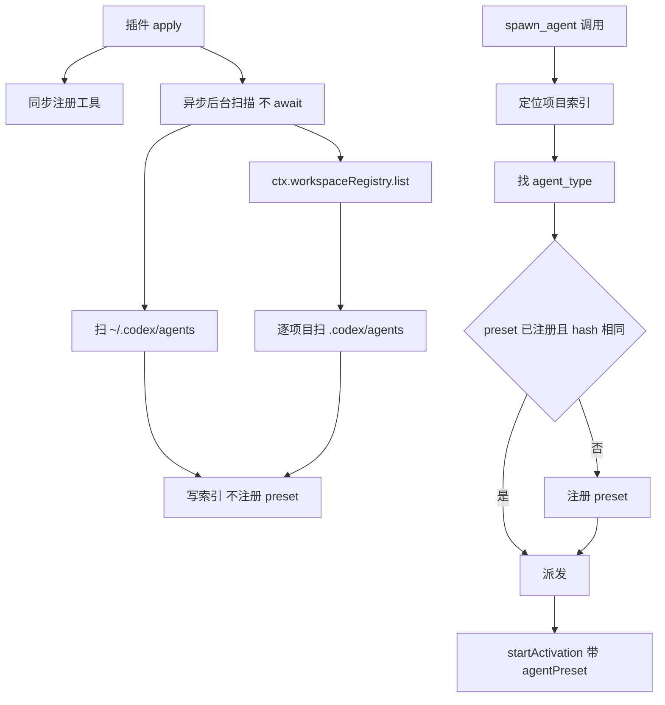

# dsh-codex-agents 执行计划

- 版本：v1
- 日期：2026-10-25
- 状态：待审核

## 目标

写一个 DSH 插件，暴露与 Codex 同签名的 `spawn_agent` 工具，让同一份 SKILL.md 能在 Codex 和 DSH 两边通用。角色定义直接复用 Codex 的 `.codex/agents/*.toml`，支持项目级与全局两级，DSH 侧通过注册 agent preset 实现人格与工具隔离。

## 成功标准

1. 项目里有 `.codex/agents/*.toml` 时，`spawn_agent(task_name, agent_type, message)` 能起一个带该 toml 人格的子 agent。
2. 不同项目各自用自己的 `.codex/agents/`，同名角色互不干扰。
3. 找不到 `agent_type` 时明确报错并列出可用角色，不静默回退。
4. 启动不被阻塞，UI 不因扫描卡顿。
5. 改 toml 后，下一次调用生效，无需重启。

## 命名

| 项 | 值 | 说明 |
|---|---|---|
| 包名 | `dsh-codex-agents` | npm 可用，已核实 |
| 工具名 | `spawn_agent` | 与 Codex 一致 |
| preset id | toml 的 `name` 字段 | 冲突时降级为 `<name>_<hash8>` |

npm 上另三个候选 `dsh-spawn-agent`、`dsh-codex-subagents`、`dsh-codex-agent-bridge` 也可用；`dsh-agent-bridge` 已被占用。

## 已核实的技术前提

| 事实 | 依据 |
|---|---|
| `SubagentStartRequest` 有 `agentPreset` 字段 | `dsh-subagent/lib/index.js`：`composition: { agentPreset: request.agentPreset }` |
| `request.persona` 已从请求移除 | `applyChildOverrides` 读 `composition.persona`，但 `startActivation` 只填 `agentPreset` |
| preset 是设置子 agent 人格与工具集的唯一公开路径 | 同上；非公开路径为 `reserveChildComposition`，`dsh-subagent-registry` 在用 |
| `ctx.agentPresets.register(definition)` 是公开 API | `dsh-agent-preset-registry/lib/index.js`，返回 disposer |
| `register()` 立即 `activate()` 并建完整插件树 | 同上：`record.ready = this.activate(record)` |
| `ctx.workspaceRegistry.list()` 返回全部项目 | `dsh-workspace/lib/index.js` |
| DSH 内置 Node 24.21，无 `node:toml` | 实测 `import('node:toml')` 失败 |
| `request.prompt` 是 `ContentBlock[]` 而非字符串 | `dsh-tool-subagent` 构造 request 的代码 |
| `defineTool` 来自 `@deepseek-ai/dsh-tools` | `dsh-tool-subagent` 的 import |

## 插件结构

```
dsh-codex-agents/
├── package.json          name=dsh-codex-agents, type=module, dsh.bundle.patch
├── cordis.patch.yml      insert 一行，id=dsh-codex-agents
├── tsconfig.json
├── src/
│   ├── index.ts          插件入口、配置 schema、工具注册、启动扫描
│   ├── toml.ts           TOML 解析 + 字段校验
│   ├── discover.ts       目录发现：项目向上查找 + 全局回退
│   ├── index-cache.ts    索引读写
│   ├── preset.ts         toml 转 preset definition + 懒注册 + 去重
│   ├── tool.ts           spawn_agent 工具定义与派发
│   └── base-plugins.ts   基础工具清单
└── test/*.test.mjs       node:test 单元测试
```

## 数据流



## 分模块设计

### 1. 目录发现 `discover.ts`

```ts
findAgentsDir(cwd: string): string | undefined
```

从 `cwd` 向上逐级查找 `.codex/agents/`，找到最近的返回；到文件系统根仍未找到则回退 `~/.codex/agents`（若存在）；都不存在返回 `undefined`。只检查目录是否存在，不读内容。

### 2. TOML 解析 `toml.ts`

依赖 `smol-toml`。

```ts
interface CodexAgent {
  name: string                    // 必填
  description: string             // 必填
  developerInstructions: string   // 必填
  model?: string                  // 读取但忽略
  modelReasoningEffort?: string   // 读取但忽略
  sandboxMode?: string            // 读取但忽略
}
```

校验规则：

- 缺 `name` / `description` / `developer_instructions` 抛错，错误信息含文件路径
- `name` 不匹配 `^[A-Za-z0-9_-]+$` 抛错
- 未知键忽略，与 Codex 行为一致
- 解析失败只影响该文件，不影响同目录其他文件

### 3. 索引缓存 `index-cache.ts`

路径 `<project>/.dsh/agents-index.json`，不存在则创建 `.dsh` 目录。

```json
{
  "version": 1,
  "scannedAt": "2026-10-25T00:00:00.000Z",
  "agentsDir": ".codex/agents",
  "agents": [
    {
      "name": "implementation_reviewer",
      "file": "implementation-reviewer.toml",
      "mtimeMs": 1761300000000,
      "hash": "a1b2c3d4",
      "presetId": "implementation_reviewer"
    }
  ]
}
```

- 只存元数据，不存 persona 正文；真相始终在 toml 里
- 读缓存后对每个文件 `stat`，`mtimeMs` 变化则重新解析并更新
- 缓存损坏或版本不符则丢弃并全量重扫，不报错
- 文件消失则从索引移除该条目

### 4. preset 构建 `preset.ts`

```js
{
  id: presetId,
  name: agent.name,
  description: agent.description,
  plugins: [
    { id: 'persona', name: '@deepseek-ai/dsh-persona',
      config: { prefix: agent.developerInstructions } },
    ...BASE_PLUGINS
  ]
}
```

`BASE_PLUGINS`（`base-plugins.ts`）从 `standard.patch.yml` 摘取，刻意不含 `tool-subagent` / `tool-workflow` / `tool-plugin-manager`，避免子 agent 无限套娃：

| 插件 | 说明 |
|---|---|
| `dsh-agent-instructions` | AGENTS.md 加载，maxBytes 65536 |
| `dsh-time-context` | 时间上下文 |
| `dsh-tool-bash` / `dsh-tool-pwsh` | 按平台 disabled |
| `dsh-tool-fs` | 文件读写 |
| `dsh-tool-fs-search` | 搜索 |
| `dsh-tool-jobs` | 后台任务 |
| `dsh-skill-filesystem` + `dsh-tool-skill` | skill 能力 |
| `dsh-tool-todo` | 待办 |

注册策略：

- `hash = sha256(文件全文).slice(0, 8)`
- 候选 id 为 `agent.name`
- id 未注册则注册并返回
- id 已注册且 hash 相同则直接复用
- id 已注册但 hash 不同则注册 `<name>_<hash8>`
- 已注册的 hash 记录在内存 Map（`presetId` 到 `hash`），不持久化
- 不注销 preset，避免续跑时出现 `agent-preset/not-found`

### 5. `spawn_agent` 工具 `tool.ts`

签名与 Codex 对齐：

```
spawn_agent(
  task_name: string,    // 合法下划线名，传给 label 与日志
  agent_type: string,   // 必须等于 toml 的 name 字段
  message: string       // 自足的任务描述
)
```

`execute` 流程：

1. 取 `exec.agent.session.header.cwd`，缺失则报错
2. 从 cwd 向上找 `.codex/agents/`，反推项目根
3. 读 `<projectRoot>/.dsh/agents-index.json`，`stat` 比对 mtime，必要时重扫
4. 索引中找 `name === agent_type`
   - 找不到则抛错：`Unknown agent_type "xxx". Available: a, b, c. (scanned <dir>)`
5. `ensurePresetRegistered` 得到 `presetId`
6. 派发：

```js
await ctx.subagents.startActivation({
  provider: 'spawn',
  label: task_name,
  request: {
    prompt: [{ type: 'text', text: message }],
    parent: exec.agent,
    agentPreset: presetId,
  },
  signal: exec.signal,
  delivery: 'parent',
})
```

7. 返回 `started subagent <childId>`，与官方 `subagent` 工具输出格式一致

### 6. 插件入口 `index.ts`

```ts
export function apply(ctx, config) {
  ctx.tools.register(spawnAgentTool(ctx, config))   // 同步，快
  void warmUp(ctx, config).catch(err => ctx.logger?.warn?.(...))  // 异步，不 await
}
```

`warmUp`：

1. 扫 `~/.codex/agents/`，建全局索引
2. `ctx.workspaceRegistry.list()` 取全部项目
3. 逐项目：路径存在则扫 `.codex/agents/`，写 `<project>/.dsh/agents-index.json`
4. 全程不注册 preset
5. 单个项目失败只记日志，不中断

配置 schema（`schemastery`）：

| 字段 | 默认 | 说明 |
|---|---|---|
| `toolName` | `spawn_agent` | 工具名 |
| `provider` | `spawn` | subagent provider |
| `agentsDirName` | `.codex/agents` | 相对项目根 |
| `searchParents` | `true` | 是否向上查找 |
| `maxParentDepth` | `8` | 向上层数上限 |
| `maxDepth` | 继承 Host | 委派深度 |

## 边界与失败处理

| 场景 | 行为 |
|---|---|
| 项目无 `.codex/agents/` | 回退到 `~/.codex/agents`；都没有则调用报错 |
| toml 缺必填字段 | 该条目不进索引，索引记 `error`；调用时报错含原因 |
| toml 解析失败 | 同上，不影响同目录其他文件 |
| `agent_type` 不匹配任何 name | 报错并列出可用角色 |
| preset 注册失败 | 报错含 preset 诊断，不静默回退到无 preset |
| 两个项目同名角色 | 各自索引记录不同 `presetId`，互不干扰 |
| 项目目录被删除 | 扫描时跳过并记日志 |
| `.dsh` 目录不可写 | 索引降级为内存缓存，记 warn |
| 并发调用同一 agent | `ensurePresetRegistered` 用 Promise Map 去重 |

## 测试

用 `node:test`，只测纯函数，不依赖 DSH 运行时：

| 测试文件 | 覆盖 |
|---|---|
| `toml.test.mjs` | 正常解析、缺字段、非法 name、未知键忽略、多行字符串、`"""` 嵌套 |
| `discover.test.mjs` | 向上查找、深度上限、回退全局、不存在 |
| `index-cache.test.mjs` | 写入读取、mtime 失效、损坏丢弃、文件消失 |
| `preset.test.mjs` | id 生成、冲突降级、hash 去重、plugins 结构 |

不写集成测试（需真实 DSH 运行时，代价高）。集成验证靠手动。

## 验收步骤

1. 插件装进 `desktop` profile（GUI 安装，CLI 被锁）
2. 重启 DSH
3. 在 `default-workspace/.codex/agents/` 放一个测试 toml
4. 新开会话，让模型调用 `spawn_agent(task_name: "t1", agent_type: "<name>", message: "...")`
5. 问子 agent「你的职责是什么」，确认应答出 toml 里的内容
6. 确认 `.dsh/agents-index.json` 已生成
7. 改 toml 后再次调用，确认新内容生效

## 已知限制（第一版接受）

1. preset 注册后出现在预设下拉框，所有项目可见；属观感问题，不影响功能
2. `model` / `model_reasoning_effort` 忽略，子 agent 继承调用者模型
3. `sandbox_mode` 忽略，不强制只读；与 Codex 行为一致，Codex 本身也不强制
4. `mcp_servers` / `skills.config` 忽略
5. 首次调用某 agent 会慢几百毫秒，因需建插件树
6. 不做文件监听，靠 mtime 比对

## 待确认的假设

1. `smol-toml` 能否作为运行时依赖装进 profile：需验证 DSH 插件安装机制允许带依赖。若不行，改为内联最小 TOML 解析器（只支持 `key = value`、多行字符串、`[table]`，约 150 行）。
2. `ctx.workspaceRegistry` 在插件作用域可见：`dsh-workspace` 挂在 `dsh-web-app` bundle 中，插件应能通过 `ctx.get('workspaceRegistry')` 取得。若取不到，退化为只扫全局与当前 cwd。
3. 开发目录位置：`~/code/` 在当前会话工作区之外，写文件需授权。建议先在 `default-workspace/dsh-codex-agents/` 开发，完成后再决定最终位置。

## 实施顺序

1. 项目骨架与 `smol-toml` 依赖验证
2. `toml.ts` 与测试
3. `discover.ts` 与测试
4. `index-cache.ts` 与测试
5. `preset.ts` 与 `base-plugins.ts` 与测试
6. `tool.ts`
7. `index.ts`（含启动扫描）
8. 构建与手动集成验证
