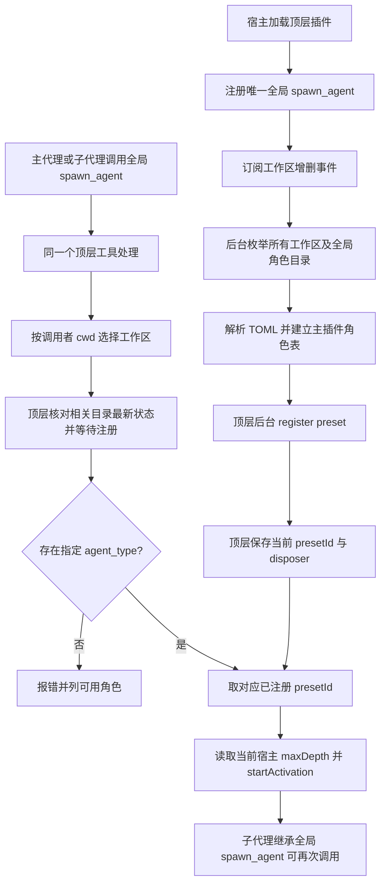

# dsh-codex-agents 执行计划

- 版本：v9
- 日期：2026-10-25
- 状态：Proposed review status: pending（待独立审核，不能由计划作者批准）
- 上一版：v8，提交 `1b5ff6be8d370d34b0a296bdfa7c8abfabbf641b`
- 目标仓库：`RekiDunois/dsh-codex-agents`，分支 `plan/dsh-codex-agents-plugin`
- 目标运行时：`@deepseek-ai/dsh-desktop-runtime@0.2.1-rc.3`
- 需求来源：PR #1 的五条成功标准及用户于 2026-10-25 在本会话确认的“顶层集中预注册、子代理纯复用、删除编号冲突管理”方案

## 1. 本版核心决定

**主界面的顶层插件是唯一的角色与预设管理者。** 宿主加载此插件后，插件只立即注册一个全局 `spawn_agent` 工具，随后取得 `ctx.workspaceRegistry.list()` 的全部已登记工作区，加上单独的 `~/.codex/agents/` 全局目录，异步扫描 TOML 并在后台调用 `ctx.agentPresets.register()`。

**子代理不再次加载 `dsh-codex-agents`。** DSH 的全局工具能被子代理继承。子代理调用的还是顶层注册的 `spawn_agent`；读取角色文件、查找角色、注册、更新与清理预设全部由顶层插件的同一管理器承担。

| 项目 | v8 | v9 |
|---|---|---|
| 注册时间 | 每次调用时按需注册 | 顶层加载后后台预注册，调用时仅由顶层按最新文件状态补充/更新 |
| 子代理 | 预设内再次加载本插件 | 直接继承宿主全局 `spawn_agent` |
| 注册归属 | 跨插件实例 `WeakMap`、`bySource`、`byId` | 顶层实例的单份内存注册记录 |
| 编号 | 五位路径哈希，冲突时 `_2`、`_3` | 路径和名称生成确定性长哈希；拒绝真实占用，不改号 |
| 索引 | `.dsh/agents-index.json` 持久化 | 不需要磁盘索引；启动重新扫描 |
| 清理 | 子实例需 `managedChild` 标志避免误清理 | 仅顶层拥有注销回调，子代理无本插件实例 |
| 工作区 | 调用时向上寻找最近的目录 | 顶层一次列出已登记工作区，监听登记变化 |

删除 v8 的 `managedChild`、`WeakMap` 跨实例共享、预设中再次加载本插件、`byId` 归属推断、编号后缀、持久索引、跨实例同模块假设与验证。历史审核评论不作为实施者必须拼接的第二套方案。

这是验收决定人主动修改正式行为，受影响审核关口为 P1—P4。与此次决定无关的构建、安装、解析库和宿主接口约定沿用旧版，以下正文是唯一有效实施方案。

## 2. 目标、范围与必须保持的行为

1. 在已登记工作区根目录的 `.codex/agents/*.toml` 中发现角色后，`spawn_agent(task_name, agent_type, message)` 能启动具有该 TOML 角色指令的子代理。
2. 不同项目同名角色隔离。全局角色与工作区角色按 `name` 合并，项目同名优先；全局独有角色仍可调用。
3. 未知 `agent_type` 清楚报错，并列出该调用者可见的项目/全局合并名单，不静默使用其他预设。
4. 插件启动不等待逐目录扫描和预设加载，主界面不会因为同步扫描停顿。
5. 修改已有 TOML 后，下一次调用该角色使用新指令，不需要重启；已经运行的旧子代理继续使用旧版。
6. 预设由顶层插件统一后台注册、更新、注销，子代理不读 TOML、不注册预设、不启动第二份插件管理器。
7. 子代理有 `spawn_agent` 可继续委派；每次调用使用 DSH 当前生效的宿主 `maxDepth` 上限。

**本版范围**：

- 工作区指宿主 `workspaceRegistry.list()` 已登记的目录，其 `path` 是规范化的绝对路径；全局 `~/.codex/agents/` 不属于工作区列表，单独扫描。
- 只扫描每个工作区**根目录**的 `.codex/agents/`。会话位于工作区子目录时，仍选该工作区的角色目录。取消 v8 向任意父目录查找最近角色目录的 `searchParents`、`maxParentDepth`。
- 调用者 `cwd` 不匹配任何已登记工作区时，只能选择全局角色；不假装创建新工作区、不读取其它未知项目。
- 不承诺文件保存时立即刷新全部预设；保证**下一次调用之前**由顶层检查相关目录并更新。工作区增删通过宿主事件在后台响应。
- `model`、`model_reasoning_effort`、`sandbox_mode`、`mcp_servers`、`skills.config` 暂不支持；不增加额外子代理工具权限、不恢复进程重启前的子代理。
- 子代理结束与结果通知仍由 DSH 原生运行时处理，`spawn_agent` 三参数与原生 `delivery: 'parent'` 不变。

## 3. 决策依据与来源

### 正式要求

- [PR #1](https://github.com/RekiDunois/dsh-codex-agents/pull/1)：原有五条产品成功标准。
- 用户于 2026-10-25 确认的本轮修改：顶层异步扫描所有工作区和全局角色，统一注册；子代理只使用顶层内容；简化重复编号相关状态。
- [Project Consensus](https://app.notion.com/p/3d60101a85f3815a8c43f271f2b4d91d) 与 [Plan Reviewer Rule](https://app.notion.com/p/3e80101a85f3817a94cbc6eca1a76a5c)。正式测试由 [Test Engineer Rule](https://app.notion.com/p/3d80101a85f380d8a8f5ce528141e253) 及独立测试计划负责。

### 宿主实现依据

以下源码版本统一为 `deepseek-ai/deepseek-harness@22ddee3792402c3e70ec5f86a63c3e3e895a2f60`：

| 关键决策 | 已确认的宿主事实 |
|---|---|
| 列出工作区 | [WorkspaceRegistry.list()](https://github.com/deepseek-ai/deepseek-harness/blob/22ddee3792402c3e70ec5f86a63c3e3e895a2f60/packages/workspace/workspace/src/index.ts) 同步读取已登记的规范目录 `path`；不代表所有磁盘目录 |
| 感知工作区新增、移除 | [WorkspaceFeed](https://github.com/deepseek-ai/deepseek-harness/blob/22ddee3792402c3e70ec5f86a63c3e3e895a2f60/packages/api/workspace-controller/src/feed.ts) 使用 `ctx.on('domain/changed')` 观察 `workspace` 存储域变化 |
| 全局工具供父子代理调用 | [ToolsService.register()](https://github.com/deepseek-ai/deepseek-harness/blob/22ddee3792402c3e70ec5f86a63c3e3e895a2f60/packages/core/tools/src/index.ts#L121-L152) 在未标记 agent scope 的宿主上下文注册全局工具，[工具可见性](https://github.com/deepseek-ai/deepseek-harness/blob/22ddee3792402c3e70ec5f86a63c3e3e895a2f60/packages/core/tools/src/index.ts#L191-L229) 合并全局与代理局部工具，明确限制才会隐藏 |
| 注册预设、替换和保留旧任务 | [AgentPresetRegistry](https://github.com/deepseek-ai/deepseek-harness/blob/22ddee3792402c3e70ec5f86a63c3e3e895a2f60/packages/preset/agent-preset-registry/src/index.ts#L93-L153) 的 `register` 返回 `dispose`、拒绝重复 ID；`resolve` 可报告 `broken`；卸载旧代际时保留仍在使用的版本 |
| 委派层数 | [SubagentRuntime](https://github.com/deepseek-ai/deepseek-harness/blob/22ddee3792402c3e70ec5f86a63c3e3e895a2f60/packages/subagent/subagent/src/index.ts) 的 `resolveMaxDepth()` 返回宿主当前限制；[原生工具](https://github.com/deepseek-ai/deepseek-harness/blob/22ddee3792402c3e70ec5f86a63c3e3e895a2f60/packages/subagent/tool-subagent/src/index.ts#L314-L339) 把该值写入 `startActivation` 请求 |

选择“顶层预注册 + 全局工具”是因为宿主已支持这些操作。替代方案 v8 的“子代理内加载同一插件 + 跨实例共享”和旧的“首次调用才注册”均能满足部分目标，但增加管理状态或不符合用户新增的预注册要求。启动时后台注册会消耗时间和内存，使用限并发及逐批让出事件循环控制。

## 4. 业务流与状态归属



**状态与职责**：

- 宿主 `workspaceRegistry` 管理工作区的登记、路径及变更通知。
- 仅顶层 `manager.ts` 管理目录扫描、角色数据、注册任务、固定编号和注销回调。
- 宿主 `agentPresets` 管理预设及其运行中旧版本。
- 宿主 `subagents` 负责启动、生命周期、深度限制和父子消息。
- 子代理只作为全局工具调用者；不存在子插件管理器，也没有跨插件实例共享对象。

## 5. 交付文件、包配置与安装

```text
dsh-codex-agents/
├── package.json
├── cordis.patch.yml
├── tsconfig.json
├── locale/en.json
├── locale/zh.json
├── icon.svg
├── src/
│   ├── index.ts          顶层加载、服务声明、全局工具和生命周期
│   ├── workspaces.ts     已登记工作区列表、当前会话归属、变更事件
│   ├── toml.ts           TOML 解析、字段与名称校验
│   ├── roster.ts         项目与全局角色合并
│   ├── preset.ts         预设内容、确定性 ID、注册及替换
│   ├── base-plugins.ts   子代理基础工具，不包含本插件
│   ├── manager.ts        唯一顶层角色表与后台队列
│   └── tool.ts           唯一全局 spawn_agent 定义与派发
├── lib/                  发布的 ESM 及声明产物
└── test/                 生产模块必要的单元测试
```

取消 `src/index-cache.ts`、旧 `discover.ts` 的任意父目录搜索以及 `.dsh/agents-index.json`。不为本功能写额外通用持久状态程序。

保留 v8 的发布约定：

- `package.json`：`name=dsh-codex-agents`、`type=module`、`main=./lib/index.js`、`types=./lib/index.d.ts`、`exports["."]` 对应同一对产物；`files` 包含 `lib/**/*.js`、`lib/**/*.d.ts`、`cordis.patch.yml`、`locale/*.json`、`icon.svg` 及说明文件；`dsh.bundle.patch=./cordis.patch.yml`。
- 普通 `dependencies` 包含运行期 `@deepseek-ai/schemastery@3.18.5`、`smol-toml@^1.9.1`。
- `peerDependencies` 使用宿主实例：`@deepseek-ai/cordis >=4.0.5 <5`，`@deepseek-ai/dsh-tools`、`@deepseek-ai/dsh-subagent`、`@deepseek-ai/dsh-agent-preset-registry`、新增 `@deepseek-ai/dsh-workspace` 和 `@deepseek-ai/dsh-storage-domain` 均按目标宿主版本 `>=0.2.1-rc.3 <0.3.0`；`devDependencies` 锁定对应目标包版本，并提供 `typescript` 与 `@types/node`。
- `tsconfig.json` 一份：`target=ES2023`、`module=NodeNext`、`moduleResolution=NodeNext`、`rootDir=src`、`outDir=lib`、`declaration=true`、`strict=true`、`noEmitOnError=true`。
- `npm run build` 生成 `lib/index.js` 和 `lib/index.d.ts`，`npm run typecheck` 不写产物，`prepack` 负责打包前构建。安装采用正式 `dsh plugin add`，不使用开发路径、手改消费者或复制产物。
- `Config` 由 `schemastery` 定义最小有效配置，工具名固定 `spawn_agent`，provider 固定 `spawn`，目录固定 `.codex/agents`。移除插件级 `maxDepth`、`indexFileName`、`searchParents`、`maxParentDepth`、冲突后缀等配置。

## 6. 顶层插件加载与工作区扫描

### 6.1 顶层入口

`src/index.ts` 必须声明：

```ts
export const name = 'dsh-codex-agents'
export const inject = ['tools', 'subagents', 'agentPresets', 'workspaceRegistry']
export const Config = /* schemastery 最小配置 */

export function apply(ctx, config) {
  // 构造唯一主插件 manager
  // 通过 ctx.tools.register 注册全局 spawn_agent
  // 订阅工作区变化，登记退出时统一清理
  // apply 返回后才调度后台扫描；不 await 全部注册
}
```

`inject` 保证四个服务可用。顶层工具注册发生在没有代理作用域的主插件中，不允许在子代理局部重复注册。`apply` 不逐目录读文件、不同步注册预设；使用后续事件循环任务运行扫描队列，避免自身激活尚未完成时等待预设插件树。

### 6.2 首次后台预注册

1. 取得 `ctx.workspaceRegistry.list()` 的所有规范化工作区 `path`，另从进程 `HOME` 定位 `~/.codex/agents/`。没有目录视为空，不创建、不扫描用户无关目录。
2. 主管理器使用异步文件读取列举每个根目录下 `*.toml`，解析并维护分别按工作区、全局分类的角色名单。
3. 将当前角色送入同一个限制并发数量的后台注册队列，按小批处理并主动让出事件循环。`register` 会加载完整的预设插件树，所以不允许无界并发预注册。
4. 每个角色只发布完成 `register` 且经过 `resolve` 诊断为可用的 `presetId`。单个错误文件或预设只影响自身。
5. 如果工具调用先于该角色扫描结束，主管理器等待或优先处理该角色/目录的后台任务，不能把“还在加载”误报成未知角色。

### 6.3 工作区增删

- 在主插件中监听 `ctx.on('domain/changed', ...)`；只对 `domain === 'workspace'` 的登记变化安排一次合并更新，再读 `workspaceRegistry.list()` 得到权威目录列表，不自己解释历史工作区数据。
- 新增工作区：后台扫描其固定角色目录并注册；删除工作区：把其项目角色移出可选名单并注销主插件持有的预设，保留其它工作区与全局角色。
- 初始扫描与工作区删除同时发生时，处理任务之前重新确认工作区仍登记；已失效的结果不得重新加入名单。正在运行的旧子代理交给宿主旧代际管理。

### 6.4 角色文件变化

- 下一次委派之前，**由主插件管理器**核对相关工作区和全局目录的当前文件名单、`mtimeMs` 和 `size`，识别新增、删除及修改，只重新解析有变化的文件。
- 同名项目角色始终优先于全局；有文件新增时角色能进入名单。扫描和更新统一串行处理同一角色。
- 不采用文件监听作为正确性前提；主插件后台初扫 + 工作区增删事件 + 调用前增量核对保证上述需求。子代理没有独立扫描流程。

## 7. 角色解析、预设编号与更新

### 7.1 TOML 与名单

`smol-toml` 解析 `name`、`description`、`developer_instructions` 三个必填字段；`name` 必须符合 `^[A-Za-z0-9_-]+$`。非法文件报告路径与原因，且不影响其它合法文件。角色名以 TOML 的 `name` 为准，不从文件名推导。其它已知但本版暂不支持的字段不映射为预设配置；未知字段忽略。

`roster.ts` 以 `name` 合并当前工作区角色和全局角色，项目优先，全局独有仍保留，报错名单按名称排序。**同一目录下两个文件声明相同 `name` 时不任意覆盖**，将该名字标为有冲突，不作为可用角色；跨目录的同名则按项目优先规则处理。

### 7.2 单份内存状态与简单编号

唯一主插件保存：

```ts
type RoleKey = string // scope + 规范化来源目录 + name
type PresetRecord = {
  presetId: string
  file: string
  mtimeMs: number
  size: number
  dispose: () => Promise<void>
}
// manager 按 RoleKey 维护有效记录、错误状态及短暂排队任务
```

- `RoleKey` 由角色来源类型、规范化工作区/全局目录和 TOML `name` 唯一描述。
- `presetId` 固定为 `dshca_<name>_<hash24>`，其中 `hash24` 是上述三项按固定次序编码后的 `SHA-256` 前 **24 位十六进制字符**。不包含 TOML 正文，因此更新文件不改编号；不同工作区同名角色有不同来源标识。
- 不做 `_2`、`_3` 等后缀分配，不维护 `byId` 所有权推断，也不使用磁盘缓存恢复编号。
- 宿主本身会在重复 ID 时拒绝 `register`。如果真正发生编号占用或哈希碰撞，本插件明确报错，**不覆盖其他定义、不静默改号**。这保留最小安全处理，不恢复旧版复杂的冲突调解。

### 7.3 预设内容

`src/preset.ts`：

```js
{
  id: presetId,
  name: agent.name,
  description: agent.description,
  plugins: [
    { id: 'persona', name: '@deepseek-ai/dsh-persona',
      config: { prefix: agent.developerInstructions } },
    ...BASE_PLUGINS
  ]
}
```

`BASE_PLUGINS` 保留 v8 的基础能力：`dsh-agent-instructions`、`dsh-time-context`、按平台启用的命令工具、`dsh-tool-fs`、`dsh-tool-fs-search`、`dsh-tool-jobs`、`dsh-skill-filesystem`、`dsh-tool-skill`、`dsh-tool-todo`。**明确删除其中的 `dsh-codex-agents`**；全局 `spawn_agent` 在代理执行时从宿主工具表继承。

### 7.4 注册、替换、注销

- 首次出现：主插件解析文件、计算固定 ID，调用 `ctx.agentPresets.register`；保存它返回的真实注销回调，并调用 `resolve(id)` 检查 `broken`。失败时清理本次注册并报告错误，不把失败定义视为可用。
- 文件未变化：复用已经注册的同一预设，不二次调用 `register`。
- 文件已变化：同一 `RoleKey` 串行执行旧 `dispose`、用同编号 `register` 新预设、`resolve` 复核、替换内存记录。若注册失败，返回真实错误；绝不悄悄复用旧指令或重新分配编号。
- 同一角色的**核对和获得注册、直到当前 `startActivation` 接受启动**放在同一短暂串行区间，防止提交给宿主前被并发注销；子代理任务开始后立刻释放锁，不锁到任务结束。不同角色不需要全局互斥。
- 删除文件或工作区时主插件清除相应可选记录并注销其自己的定义。运行中的旧子代理由宿主按照预设代际保留规则完成，不强制终止。
- 主插件卸载时停止接纳新调用和后台队列，撤销事件监听，等待已经开始的注册操作收尾，然后仅调用自己持有的全部 `dispose`，清空内存。重新激活重新扫描，不持有跨生命周期状态；子代理没有清理责任。

## 8. 全局 `spawn_agent` 委派

`src/tool.ts` 的工具签名固定：

```text
spawn_agent(
  task_name: string,
  agent_type: string,
  message: string
)
```

执行顺序：

1. 从 `exec.agent.session.header.cwd` 取得真实调用者工作目录。用已登记的工作区规范路径匹配工作区；子目录属于包含它的最长已登记根目录，匹配不到则仅有全局角色。缺 cwd 时明确报错。
2. 调用主插件管理器确认当前工作区及全局角色表已完成相关扫描与更新，遇到未结束的后台任务则等待该任务。**执行入口是主插件注册的全局工具，不是子实例函数。**
3. 从项目优先、全局兜底的名单中以 `agent_type` 精确查找。找不到时抛 `Unknown agent_type ... Available: ...`，列出调用者实际可见角色，不泄露其它项目私有名单。
4. 找到已注册的 `presetId`，在同角色短锁保护下，**每次调用** `ctx.subagents.resolveMaxDepth()` 获取宿主当前限制，然后由宿主 `startActivation` 接受启动：

```ts
const maxDepth = ctx.subagents.resolveMaxDepth()
const started = await ctx.subagents.startActivation({
  provider: 'spawn',
  label: task_name,
  request: {
    prompt: [{ type: 'text', text: message }],
    parent: exec.agent,
    agentPreset: presetId,
    ...(maxDepth === undefined ? {} : { maxDepth }),
  },
  signal: exec.signal,
  delivery: 'parent',
})
// 返回包含 started.childId 的启动结果
```

5. 子代理调用同一个 `spawn_agent` 时再次按照它自己会话的 `cwd` 选择角色，由同一主管理器执行；预设中不保存层数，不复制父请求层数。宿主 `SubagentDepthError` 和其它正式委派错误直接报告。

## 9. 错误、并发与关键反例

| 场景 | 预期方案行为 |
|---|---|
| 初始后台扫描未完成即调用 | 等待相关工作区/角色任务，不能错误返回未知角色 |
| 不同项目有相同角色名 | 由各自来源生成固定不同编号，按实际调用者工作区选角色 |
| 项目/全局同名 | 项目优先，其他工作区仍可使用全局角色 |
| 无工作区或无匹配角色 | 仅全局可用；不存在则报错并列出当前可用角色 |
| TOML 缺字段或错误 | 报对应文件与原因，其他合法角色仍可启动 |
| TOML 更新之后立即调用 | 主插件先检查并以同编号替换，新调用看到新指令 |
| 旧子代理仍在运行时更新 | 宿主保留旧代际直到旧任务结束，新任务用新版 |
| 注册 ID 已被外部占用 | 宿主拒绝，本插件报错，不覆盖、不自动改号 |
| 新登记或移除工作区 | 顶层增量扫描或注销；旧的后台任务不得重新注册已移除工作区 |
| 子代理递归调用 | 调用顶层全局工具，不另建管理器、不会读 TOML/注册预设 |
| 超过委派深度 | 宿主原生 `SubagentDepthError`，不得绕过上限 |
| 主插件卸载后又加载 | 由旧主插件清理它持有的注册，新实例重新扫描，不复用失效内存 |

必须保持的约束：

- 每个角色来源在一个顶层插件实例内至多有一条有效当前注册记录。
- 只有顶层实例读角色文件、调用 `agentPresets.register`、持有和调用 `dispose`。
- 同一路径同名角色的编号保持稳定，更新不增加下拉框中不同编号条目。
- 同名角色在项目之间不串用；错误列表也只来自调用者可见的项目和全局角色。
- 任何委派从宿主当前配置取得层数，不因子代理调用来源改变上限。

## 10. 影响、已知限制与责任

| 类别 | 内容 |
|---|---|
| `intended_change` | 主插件后台预注册所有已登记工作区和全局角色；一个全局工具供父子调用；删去跨实例注册 |
| `preserved_behavior` | 三参数接口、项目优先、跨工作区隔离、找不到报错、文件更新后下次调用生效、旧任务沿用旧人格、宿主层数限制 |
| `approved_behavior_change` | 2026-10-25 用户明确要求顶层统一注册、子代理纯复用、精简编号状态；工作区以宿主已登记列表为来源 |
| `prohibited_side_effect` | 不同步阻塞插件启动，不扫描其它无关项目，不在子代理重复注册，不覆盖外部预设，不放宽宿主递归限制 |
| `unresolved impact` | 预注册所有角色可能占用更多内存和后台 CPU；采用单一队列、有限并发及让出事件循环，不把预注册完成作为 UI 启动前提 |

**责任归属**：工作区名单属于宿主 `workspaceRegistry`；扫描、解析、注册记录与注销属于主插件；预设代际属于宿主 `agentPresets`；派发与递归上限属于宿主 `subagents`。没有额外子插件所有者。

**已知限制**：预注册的全部角色可能出现在宿主预设下拉框；路径变化后固定编号会变化；不做常驻文件监听，但调用前由顶层核对保证新指令；宿主缺少 `workspaceRegistry` 时主插件按 `inject` 保持未激活并由宿主提示缺少服务；不自动处理极罕见的 ID 占用。

## 11. 实施顺序及交接

1. **建立可安装骨架**：`package.json`、`cordis.patch.yml`、`tsconfig.json`、语言文件、图标、`src/index.ts` 最小可加载入口；补齐新增 `dsh-workspace`、`dsh-storage-domain` 类型/宿主依赖。
2. **先打通正式安装载体**：`npm install`、`npm run build`、`npm run typecheck`、`npm pack`，然后在独立 `DSH_HOME` 的 `web` 配置档用正式 `dsh plugin add` 加载产物；失败应修生产包，不手改消费目录。
3. **工作区接入**：实现 `workspaces.ts` 的 `workspaceRegistry.list()` 获取全部目录、全局 `HOME` 路径、增删事件与调用者 `cwd` 的工作区对应。
4. **解析与名单**：实现 `toml.ts`、`roster.ts`；按 TOML `name` 校验，项目/全局合并。
5. **预设定义**：实现 `preset.ts`、`base-plugins.ts`；固定来源 ID，保留基础工具与角色人格，确保 `BASE_PLUGINS` **不含本插件**。
6. **顶层注册管理器**：实现 `manager.ts` 的异步初扫、限并发预注册、角色变更刷新、`resolve` 可用诊断、注销与卸载；去掉 `index-cache.ts`、磁盘索引、`WeakMap` 和后缀流程。
7. **统一全局工具**：实现 `tool.ts`，主插件仅注册一次 `spawn_agent`；所有调用按工作区选预设，读取当时宿主 `maxDepth`，调用 `startActivation`，子代理通过全局工具再委派。
8. **最终接线与交付**：`index.ts` 只管理主插件生命周期；确保注册在 `apply` 返回后异步运行。对目标生产版本重新构建、正式安装，交给测试计划负责人按已批准业务范围进行验证。

**隔离要求**：正式产品测试使用独立 `HOME="$BASE/test-home"` 和 `DSH_HOME`，全局测试角色位于 `$BASE/test-home/.codex/agents/`。不得操作真实用户全局目录、配置档或生产会话；已认可的正式安装和执行记录按适用范围复用。

**独立测试计划**：本轮只修订 `plan/dsh-codex-agents.md`。另一个文件 `plan/dsh-codex-agents-test-plan.md` 的“首次调用才注册、预设内再加载插件、索引文件生成”等旧预期如有，应由测试计划负责人按受影响范围修订；不能根据本执行计划自行增加用例、命令或测试前置条件。

**实施状态**：计划 v9 为待审版本；本次仅更新计划，不代表实现完成、测试通过或允许合并。实施核心方案前须有独立正式 `Plan conclusion: APPROVED`，实施者只参照本文件，不拼接历史评论。