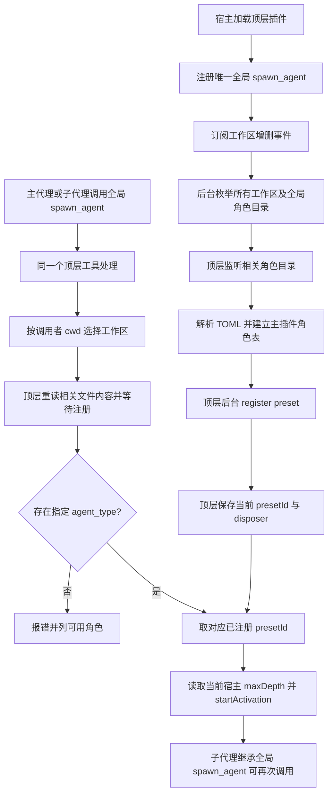

# dsh-codex-agents 执行计划

- 版本：v10
- 日期：2026-10-25
- 状态：Proposed review status: pending（待独立审核，不能由计划作者批准）
- 上一版：v9，提交 `fdfff2244210edd18d1510f51564d5a23215e5d9`
- 目标仓库：`RekiDunois/dsh-codex-agents`，分支 `plan/dsh-codex-agents-plugin`
- 目标运行时：`@deepseek-ai/dsh-desktop-runtime@0.2.1-rc.3`
- 需求来源：PR #1 的业务成功标准、2026-10-25 顶层预注册决定，以及验收决定人本轮补充确认的角色目录文件监听和 `spawn_agent` 专属跨工作区隔离边界

## 1. 本版核心决定

**顶层唯一管理者。** 主插件加载后立即注册唯一的全局 `spawn_agent`，从 `ctx.workspaceRegistry.list()` 获得已登记工作区，再加上单独的 `~/.codex/agents/` 全局目录；在后台异步扫描并注册角色预设。只有主插件拥有扫描、注册、替换和注销责任。

**子代理复用全局工具。** 预设中不加载第二份 `dsh-codex-agents`；子代理通过宿主全局工具表调用同一个 `spawn_agent`，其调用仍由顶层管理器按实际工作目录判断工作区。

**目录事件监听。** 顶层对每个已登记工作区的 `.codex/agents/` 和全局角色目录建立 `node:fs.watch` 监听。事件促使后台刷新对应名单及预设；每次 `spawn_agent` 派发前仍重新读取调用者所属工作区和全局目录的文件列表、文件内容摘要，避免操作系统漏报事件或修改时间、文件大小未变化时误用旧版。两条路径共用同一更新逻辑。

**隔离仅约束 `spawn_agent`。** 项目角色优先、跨工作区同名角色选择以及未知角色错误名单仅约束此工具。宿主原生预设列表、下拉框与独立原生预设选择不属于本次隔离要求，可以看见其它工作区已预注册的角色。

| 项目 | v9 | v10 |
|---|---|---|
| 文件变化 | 启动扫描，调用前依据 `mtimeMs`、`size` 检查 | 常驻目录事件监听 + 调用前按实际文件内容核对 |
| 隔离要求 | 对宿主原生预设入口的边界不明确 | 只约束 `spawn_agent` |
| 其他设计 | 顶层预注册、全局工具、固定长哈希、无磁盘索引 | 保持不变 |

此前 v9 已取消的 `managedChild`、跨实例 `WeakMap`、`byId` 所有权推断、编号后缀、持久索引和子代理重复加载插件，本版不恢复。历史审核评论不构成第二套实施方案。

本版依据验收决定人的两项补充决定修复 v9 的文件更新判断问题，并明确原生预设入口的隔离边界。影响 P1—P4 中与监听、文件刷新、生命周期和隔离有关的决定；与此无关的打包、安装、解析库和宿主接口约定沿用 v9。

## 2. 目标、范围与必须保持的行为

1. 在已登记工作区根目录的 `.codex/agents/*.toml` 中发现角色后，`spawn_agent(task_name, agent_type, message)` 能启动具有该 TOML 角色指令的子代理。
2. 通过 `spawn_agent` 调用时，不同项目同名角色隔离；工作区角色与全局角色按 `name` 合并，项目同名优先；全局独有角色仍可调用。
3. 此工具收到未知 `agent_type` 时明确报错，列出该调用者所属工作区及全局合并名单，不静默回退；不在此工具的错误信息中暴露其它工作区独有角色。
4. 插件启动不等待目录扫描、监听初始化和预设加载，主界面不会因为同步扫描阻塞。
5. 顶层监听相关目录的新增、修改、删除事件并异步刷新；修改角色 TOML 后，下一次 `spawn_agent` 调用之前再次核对文件内容，使用最新指令而无需重启。运行中的旧子代理继续使用旧版。
6. 角色监听、扫描、预设注册、更新、注销由顶层管理；子代理不启动第二份插件管理器。
7. 子代理拥有相同的全局 `spawn_agent`，可继续委派，每次使用 DSH 当前生效的宿主 `maxDepth`。

**范围与非目标**：

- 工作区来自宿主 `workspaceRegistry.list()`，其 `path` 是规范化绝对路径；只处理已登记工作区根目录的 `.codex/agents/` 和单独的全局 `~/.codex/agents/`。不扫描或监听未登记的其它项目。
- 子会话位于已登记工作区的子目录时仍使用该工作区角色；调用者 `cwd` 不匹配任何已登记工作区时，只能选择全局角色。取消 v8 任意父目录查找。
- 文件事件到达后在后台尽早刷新；不承诺文件保存瞬间就完成注册，但保证下一次委派前核对当前目录的文件内容。新工作区和删除工作区通过宿主事件更新监听与注册。
- 跨工作区角色隔离只约束 `spawn_agent` 的查找和错误名单。宿主原生预设列表、预设下拉框和独立原生预设选择不在本版隔离范围内；不修改宿主原生权限或预设注册表的可见性。
- `model`、`model_reasoning_effort`、`sandbox_mode`、`mcp_servers`、`skills.config` 暂不支持；不增加额外子代理工具权限、不恢复进程重启前的子代理。
- 子代理结束与结果通知仍由 DSH 原生运行时处理；`spawn_agent` 三参数与 `delivery: 'parent'` 不变。

## 3. 决策依据与来源

### 正式要求

- [PR #1](https://github.com/RekiDunois/dsh-codex-agents/pull/1)：原有五条产品成功标准。
- 用户于 2026-10-25 确认的顶层预注册方案，以及本轮明确的“监听对应角色目录文件变化”“工作区隔离只约束 `spawn_agent`”两项补充决定。
- [Project Consensus](https://app.notion.com/p/3d60101a85f3815a8c43f271f2b4d91d) 与 [Plan Reviewer Rule](https://app.notion.com/p/3e80101a85f3817a94cbc6eca1a76a5c)。正式测试由 [Test Engineer Rule](https://app.notion.com/p/3d80101a85f380d8a8f5ce528141e253) 及独立测试计划负责。

### 宿主实现依据

以下源码版本统一为 `deepseek-ai/deepseek-harness@22ddee3792402c3e70ec5f86a63c3e3e895a2f60`：

| 关键决策 | 已确认的宿主事实 |
|---|---|
| 列出工作区 | [WorkspaceRegistry.list()](https://github.com/deepseek-ai/deepseek-harness/blob/22ddee3792402c3e70ec5f86a63c3e3e895a2f60/packages/workspace/workspace/src/index.ts) 同步读取已登记的规范目录 `path`；不代表所有磁盘目录 |
| 感知工作区新增、移除 | [WorkspaceFeed](https://github.com/deepseek-ai/deepseek-harness/blob/22ddee3792402c3e70ec5f86a63c3e3e895a2f60/packages/api/workspace-controller/src/feed.ts) 使用 `ctx.on('domain/changed')` 观察 `workspace` 存储域变化 |
| 全局工具供父子代理调用 | [ToolsService.register()](https://github.com/deepseek-ai/deepseek-harness/blob/22ddee3792402c3e70ec5f86a63c3e3e895a2f60/packages/core/tools/src/index.ts#L121-L152) 在未标记 agent scope 的宿主上下文注册全局工具，[工具可见性](https://github.com/deepseek-ai/deepseek-harness/blob/22ddee3792402c3e70ec5f86a63c3e3e895a2f60/packages/core/tools/src/index.ts#L191-L229) 合并全局与代理局部工具，明确限制才会隐藏 |
| 注册预设、替换和保留旧任务 | [AgentPresetRegistry](https://github.com/deepseek-ai/deepseek-harness/blob/22ddee3792402c3e70ec5f86a63c3e3e895a2f60/packages/preset/agent-preset-registry/src/index.ts#L93-L153) 的 `register` 返回 `dispose`、拒绝重复 ID；`resolve` 可报告 `broken`；卸载旧代际时保留仍在使用的版本 |
| 委派层数 | [SubagentRuntime](https://github.com/deepseek-ai/deepseek-harness/blob/22ddee3792402c3e70ec5f86a63c3e3e895a2f60/packages/subagent/subagent/src/index.ts) 的 `resolveMaxDepth()` 返回宿主当前限制；[原生工具](https://github.com/deepseek-ai/deepseek-harness/blob/22ddee3792402c3e70ec5f86a63c3e3e895a2f60/packages/subagent/tool-subagent/src/index.ts#L314-L339) 把该值写入 `startActivation` 请求 |

选择“顶层预注册 + 全局工具”是因为宿主已支持这些操作。替代方案 v8 的“子代理内加载同一插件 + 跨实例共享”和旧的“首次调用才注册”均能满足部分目标，但增加管理状态或不符合用户新增的预注册要求。启动时后台注册会消耗时间和内存，使用限并发及逐批让出事件循环控制。

**文件监听的已知行为**：[Node.js 24 文件系统文档](https://nodejs.org/download/release/v24.17.0/docs/api/fs.html)说明 `fs.watch` 可以监听目录的 `change` 和 `rename`，但事件的文件名可能缺失；目录被删除并重建时旧监听可能继续绑定旧文件节点，部分文件系统也可能丢失事件。两种可行方向是“仅在调用时重新读取内容”与“监听事件 + 调用前重新读取内容”。采用后者：事件负责提前刷新，调用前读取确保更新不会因漏报而失效；不把 `mtimeMs`、`size` 视为内容相同的证据。

## 4. 业务流与状态归属



**状态与职责**：

- 宿主 `workspaceRegistry` 管理工作区的登记、路径及变更通知。
- 仅顶层 `manager.ts` 管理目录扫描、角色数据、注册任务、固定编号和注销回调；它持有的 `watch.ts` 负责监听、重新绑定和退出清理。
- 宿主 `agentPresets` 管理预设及其运行中旧版本。
- 宿主 `subagents` 负责启动、生命周期、深度限制和父子消息。
- 子代理只作为全局工具调用者；不存在子插件管理器，也没有跨插件实例共享对象。

## 5. 交付文件、包配置与安装

```text
dsh-codex-agents/
├── package.json
├── cordis.patch.yml
├── tsconfig.json
├── locale/en.json
├── locale/zh.json
├── icon.svg
├── src/
│   ├── index.ts          顶层加载、服务声明、全局工具和生命周期
│   ├── workspaces.ts     已登记工作区列表、当前会话归属、变更事件
│   ├── watch.ts          文件目录监听、事件合并、路径重绑与清理
│   ├── toml.ts           TOML 解析、字段与名称校验
│   ├── roster.ts         项目与全局角色合并
│   ├── preset.ts         预设内容、确定性 ID、注册及替换
│   ├── base-plugins.ts   子代理基础工具，不包含本插件
│   ├── manager.ts        唯一顶层角色表与后台队列
│   └── tool.ts           唯一全局 spawn_agent 定义与派发
├── lib/                  发布的 ESM 及声明产物
└── test/                 生产模块必要的单元测试
```

取消 `src/index-cache.ts`、旧 `discover.ts` 的任意父目录搜索以及 `.dsh/agents-index.json`。不为本功能写额外通用持久状态程序。

保留 v8 的发布约定：

- `package.json`：`name=dsh-codex-agents`、`type=module`、`main=./lib/index.js`、`types=./lib/index.d.ts`、`exports["."]` 对应同一对产物；`files` 包含 `lib/**/*.js`、`lib/**/*.d.ts`、`cordis.patch.yml`、`locale/*.json`、`icon.svg` 及说明文件；`dsh.bundle.patch=./cordis.patch.yml`。
- 普通 `dependencies` 包含运行期 `@deepseek-ai/schemastery@3.18.5`、`smol-toml@^1.9.1`。
- `peerDependencies` 使用宿主实例：`@deepseek-ai/cordis >=4.0.5 <5`，`@deepseek-ai/dsh-tools`、`@deepseek-ai/dsh-subagent`、`@deepseek-ai/dsh-agent-preset-registry`、新增 `@deepseek-ai/dsh-workspace` 和 `@deepseek-ai/dsh-storage-domain` 均按目标宿主版本 `>=0.2.1-rc.3 <0.3.0`；`devDependencies` 锁定对应目标包版本，并提供 `typescript` 与 `@types/node`。
- `tsconfig.json` 一份：`target=ES2023`、`module=NodeNext`、`moduleResolution=NodeNext`、`rootDir=src`、`outDir=lib`、`declaration=true`、`strict=true`、`noEmitOnError=true`。
- `npm run build` 生成 `lib/index.js` 和 `lib/index.d.ts`，`npm run typecheck` 不写产物，`prepack` 负责打包前构建。安装采用正式 `dsh plugin add`，不使用开发路径、手改消费者或复制产物。
- `Config` 由 `schemastery` 定义最小有效配置，工具名固定 `spawn_agent`，provider 固定 `spawn`，目录固定 `.codex/agents`。移除插件级 `maxDepth`、`indexFileName`、`searchParents`、`maxParentDepth`、冲突后缀等配置。

## 6. 顶层插件加载与工作区扫描

### 6.1 顶层入口

`src/index.ts` 必须声明：

```ts
export const name = 'dsh-codex-agents'
export const inject = ['tools', 'subagents', 'agentPresets', 'workspaceRegistry']
export const Config = /* schemastery 最小配置 */

export function apply(ctx, config) {
  // 构造唯一主插件 manager
  // 通过 ctx.tools.register 注册全局 spawn_agent
  // 订阅工作区变化，登记退出时统一清理
  // apply 返回后才调度后台扫描；不 await 全部注册
}
```

`inject` 保证四个服务可用。顶层工具注册发生在没有代理作用域的主插件中，不允许在子代理局部重复注册。`apply` 不逐目录读文件、不同步注册预设；使用后续事件循环任务运行扫描队列，避免自身激活尚未完成时等待预设插件树。

### 6.2 首次后台预注册

1. 取得 `ctx.workspaceRegistry.list()` 的所有规范化工作区 `path`，另从进程 `HOME` 定位 `~/.codex/agents/`。没有目录视为空，不创建、不扫描用户无关目录。
2. 主管理器先建立相关目录监听（目录缺失时由其现有上级承接），再用异步文件读取列举每个根目录下 `*.toml`，解析并维护工作区和全局角色名单。初扫与后续事件使用同一刷新队列，不丢弃初扫期间标记的变化。
3. 将当前角色送入同一个限制并发数量的后台注册队列，按小批处理并主动让出事件循环。`register` 会加载完整的预设插件树，所以不允许无界并发预注册。
4. 每个角色只发布完成 `register` 且经过 `resolve` 诊断为可用的 `presetId`。单个错误文件或预设只影响自身。
5. 如果工具调用先于该角色扫描结束，主管理器等待或优先处理该角色/目录的后台任务，不能把“还在加载”误报成未知角色。

### 6.3 工作区增删

- 在主插件中监听 `ctx.on('domain/changed', ...)`；只对 `domain === 'workspace'` 的登记变化安排一次合并更新，再读 `workspaceRegistry.list()` 得到权威目录列表，不自己解释历史工作区数据。
- 新增工作区：安装其角色目录监听，后台扫描并注册；删除工作区：关闭对应监听，将其角色移出名单并注销顶层持有的预设，保留其它工作区与全局角色。
- 初始扫描、目录事件与工作区删除同时发生时，扫描或注册前重新确认工作区仍登记；监听回调和队列结果需校验工作区/路径代际，已失效的结果不得重新加入名单。运行中的旧子代理交给宿主旧代际管理。

### 6.4 角色文件变化与目录监听

- `src/watch.ts` 在顶层使用 `node:fs.watch` 监听每个已登记工作区根目录的 `.codex/agents/` 及全局 `~/.codex/agents/`，以**目录**为监听单位，不逐文件监听。收到 `change` 或 `rename` 时标记相应目录为待刷新；事件没有文件名，或表示目录本身发生变化时，刷新整个对应目录。合并短时间内的重复事件，由 `manager.ts` 在后台重新列举 `*.toml`、比较内容摘要并按需注册、更新或注销预设。
- 目标目录不存在时不创建任何用户目录。监听固定路径上最近的现有上级，例如工作区根目录，遇到 `.codex/`、`agents/` 创建后逐级改绑目标目录；目录删除、重命名或监听失效后关闭旧监听，重新解析当前路径并重绑。后台只追踪已经登记的工作区及全局路径，不递归监控无关文件。
- **每次 `spawn_agent` 调用前**，顶层针对调用者所属工作区及全局角色目录，重新列举当前 `*.toml`，读取实际文件内容并计算摘要（例如 SHA-256），与已注册记录比较，检查新增、删除、修改与同名冲突；不依赖事件是否送达，也不以 `mtimeMs` 或 `size` 相等证明文件未变。等待相关更新完成后再选角色并提交委派；不重新扫描其它工作区。
- 监听抛错、事件文件名缺失或目录原子替换时，标脏并尝试重绑；监听暂不可用时保留上述调用前读取途径，不能默默沿用旧人格。目录确实不存在可视为空；其它文件读取/权限/解析错误应报告真实错误，不把不确定的内容当作旧版有效数据。
- 后台事件处理、调用前校验以及同一 `RoleKey` 的预设替换共用管理器的串行流程；相关工作区删除或顶层卸载后，旧监听事件和过期队列不得再次注册失效的角色。子代理不单独读文件或建立监听。

## 7. 角色解析、预设编号与更新

### 7.1 TOML 与名单

`smol-toml` 解析 `name`、`description`、`developer_instructions` 三个必填字段；`name` 必须符合 `^[A-Za-z0-9_-]+$`。非法文件报告路径与原因，且不影响其它合法文件。角色名以 TOML 的 `name` 为准，不从文件名推导。其它已知但本版暂不支持的字段不映射为预设配置；未知字段忽略。

`roster.ts` 以 `name` 合并当前工作区角色和全局角色，项目优先，全局独有仍保留，报错名单按名称排序。**同一目录下两个文件声明相同 `name` 时不任意覆盖**，将该名字标为有冲突，不作为可用角色；跨目录的同名则按项目优先规则处理。

### 7.2 单份内存状态与简单编号

唯一主插件保存：

```ts
type RoleKey = string // scope + 规范化来源目录 + name
type PresetRecord = {
  presetId: string
  file: string
  contentHash: string // TOML 内容摘要；只用于判断变化，不参与 presetId
  dispose: () => Promise<void>
}
// manager 按 RoleKey 维护有效记录、错误状态及短暂排队任务
```

- `RoleKey` 由角色来源类型、规范化工作区/全局目录和 TOML `name` 唯一描述。
- `presetId` 固定为 `dshca_<name>_<hash24>`，其中 `hash24` 是上述三项按固定次序编码后的 `SHA-256` 前 **24 位十六进制字符**。不包含 TOML 正文，因此更新文件不改编号；不同工作区同名角色有不同来源标识。
- 不做 `_2`、`_3` 等后缀分配，不维护 `byId` 所有权推断，也不使用磁盘缓存恢复编号。
- 宿主本身会在重复 ID 时拒绝 `register`。如果真正发生编号占用或哈希碰撞，本插件明确报错，**不覆盖其他定义、不静默改号**。这保留最小安全处理，不恢复旧版复杂的冲突调解。

### 7.3 预设内容

`src/preset.ts`：

```js
{
  id: presetId,
  name: agent.name,
  description: agent.description,
  plugins: [
    { id: 'persona', name: '@deepseek-ai/dsh-persona',
      config: { prefix: agent.developerInstructions } },
    ...BASE_PLUGINS
  ]
}
```

`BASE_PLUGINS` 保留 v8 的基础能力：`dsh-agent-instructions`、`dsh-time-context`、按平台启用的命令工具、`dsh-tool-fs`、`dsh-tool-fs-search`、`dsh-tool-jobs`、`dsh-skill-filesystem`、`dsh-tool-skill`、`dsh-tool-todo`。**明确删除其中的 `dsh-codex-agents`**；全局 `spawn_agent` 在代理执行时从宿主工具表继承。

### 7.4 注册、替换、注销

- 首次出现：主插件解析文件、计算固定 ID，调用 `ctx.agentPresets.register`；保存它返回的真实注销回调，并调用 `resolve(id)` 检查 `broken`。失败时清理本次注册并报告错误，不把失败定义视为可用。
- 已核对的文件内容摘要未变：复用已经注册的预设，不二次调用 `register`；重复事件无需重复注册。
- 文件内容摘要变化：同一 `RoleKey` 串行执行旧 `dispose`、用同编号 `register` 新预设、`resolve` 复核、替换内存记录。若注册失败，返回真实错误；绝不悄悄复用旧指令或重新分配编号。目录事件和调用前核对均走此更新路径。
- 同一角色的**核对和获得注册、直到当前 `startActivation` 接受启动**放在同一短暂串行区间，防止提交给宿主前被并发注销；子代理任务开始后立刻释放锁，不锁到任务结束。不同角色不需要全局互斥。
- 删除文件或工作区时主插件清除相应可选记录并注销其自己的定义。运行中的旧子代理由宿主按照预设代际保留规则完成，不强制终止。
- 主插件卸载时停止接纳新调用和后台队列，撤销工作区事件监听并关闭所有文件目录监听，丢弃失效回调，等待已经开始的注册操作收尾，然后仅调用自己持有的全部 `dispose`，清空内存。重新激活重新绑定监听并扫描，不持有跨生命周期状态；子代理没有清理责任。

## 8. 全局 `spawn_agent` 委派

`src/tool.ts` 的工具签名固定：

```text
spawn_agent(
  task_name: string,
  agent_type: string,
  message: string
)
```

执行顺序：

1. 从 `exec.agent.session.header.cwd` 取得真实调用者工作目录。用已登记的工作区规范路径匹配工作区；子目录属于包含它的最长已登记根目录，匹配不到则仅有全局角色。缺 cwd 时明确报错。
2. 调用主插件管理器列举当前工作区和全局目录的角色文件并校验实际内容摘要，等待相关监听刷新、注册和替换完成；即使监听事件尚未送达，也不能跳过校验。**执行入口是主插件注册的全局工具，不是子实例函数。**
3. 从项目优先、全局兜底的名单中以 `agent_type` 精确查找。找不到时抛 `Unknown agent_type ... Available: ...`，列出调用者实际可见角色，不泄露其它项目私有名单。
4. 找到已注册的 `presetId`，在同角色短锁保护下，**每次调用** `ctx.subagents.resolveMaxDepth()` 获取宿主当前限制，然后由宿主 `startActivation` 接受启动：

```ts
const maxDepth = ctx.subagents.resolveMaxDepth()
const started = await ctx.subagents.startActivation({
  provider: 'spawn',
  label: task_name,
  request: {
    prompt: [{ type: 'text', text: message }],
    parent: exec.agent,
    agentPreset: presetId,
    ...(maxDepth === undefined ? {} : { maxDepth }),
  },
  signal: exec.signal,
  delivery: 'parent',
})
// 返回包含 started.childId 的启动结果
```

5. 子代理调用同一个 `spawn_agent` 时再次按照它自己会话的 `cwd` 选择角色，由同一主管理器执行；预设中不保存层数，不复制父请求层数。宿主 `SubagentDepthError` 和其它正式委派错误直接报告。

## 9. 错误、并发与关键反例

| 场景 | 预期方案行为 |
|---|---|
| 初始扫描或监听安装尚未完成即调用 | 调用前按当前目录读取文件并等待相关注册，不错误返回未知角色 |
| 不同项目有相同角色名 | `spawn_agent` 按调用者工作区选角色；各来源固定不同预设编号 |
| 项目/全局同名 | `spawn_agent` 项目优先；不匹配项目的调用者仍可使用全局角色 |
| 无匹配工作区、无匹配角色 | 仅全局可用；不存在则报错并列出当前可用角色 |
| TOML 缺字段或格式错误 | 报对应文件及原因，其他合法角色仍可启动 |
| TOML 已改但修改时间与文件大小相同 | 调用前依据实际内容摘要仍能发现变化并以同编号替换 |
| 操作系统遗漏事件或监听暂不可用 | 调用前读取当前目录实际内容，仍能启动最新可用角色 |
| `agents` 目录删除并重建、原子替换 | 原监听关闭、按当前路径重绑；调用前重新列举，不沿用旧文件节点 |
| 编辑角色后立即调用 | 等待当前文件校验及同编号替换，新调用使用新指令 |
| 旧子代理仍在运行时更新 | 宿主保留旧代际到旧任务结束，新委派使用新版本 |
| 预设 ID 已被外部占用 | 宿主拒绝，本插件报错，不覆盖、不改号 |
| 工作区登记或删除与后台任务并发 | 根据当前登记及路径代际丢弃失效更新；移除时撤销监听及注册 |
| 子代理再委派 | 继续使用主插件注册的全局工具，不新建管理器或监听 |
| 达到委派层数 | 宿主原生 `SubagentDepthError`，不绕过当前上限 |
| 原生预设列表出现其它项目角色 | 允许；本版隔离只约束 `spawn_agent` |
| 主插件卸载后再加载 | 旧实例关闭监听、清理所持预设；新实例重新建立监听、扫描 |

**必须保持的条件**：

- 每个角色来源在一个顶层插件实例内至多有一条有效当前注册记录；只有顶层实例读文件、监听目录、注册与注销预设。
- 同一路径同名角色的预设编号不随 TOML 内容变化，更新不产生额外不同编号的条目。
- `spawn_agent` 只选择调用者所属工作区与全局角色，错误名单也只来自这些目录；此条件不约束宿主原生预设选择。
- 下一次 `spawn_agent` 委派前核对上述目录实际文件内容；监听事件遗漏、文件时间和大小相同，均不能成为复用过期人格的理由。
- `spawn_agent` 的每次委派都读取宿主当前层数限制；不因调用来源不同而放宽限制。

## 10. 影响、已知限制与责任

| 类别 | 内容 |
|---|---|
| `intended_change` | 顶层后台预注册、监听已登记角色目录及全局目录、事件触发预设更新；`spawn_agent` 派发前按当前内容核对角色 |
| `preserved_behavior` | 三参数接口、`spawn_agent` 项目优先和跨工作区隔离、未知角色报错、文件更新下次调用生效、旧任务沿用旧人格、宿主递归限制 |
| `approved_behavior_change` | 2026-10-25 用户已确认顶层统一管理、子代理纯复用；本轮补充确认文件目录监听，以及工作区隔离仅约束 `spawn_agent` |
| `prohibited_side_effect` | 不同步阻塞启动；不监听或扫描无关项目；子代理不重复注册；不覆盖外部预设；不绕过递归限制；监听漏报不能使下一次工具调用沿用旧角色 |
| `unresolved impact` | 每个相关目录需要少量文件监听句柄；背景注册和刷新使用内存与 CPU。通过顶层统一管理、事件合并、限并发队列、按工作区清理和退出关闭控制；监听不可用时调用前读取内容仍保证业务行为。这些资源开销不改变当前工具约定 |

**责任归属**：工作区名单与登记状态由宿主 `workspaceRegistry` 持有；目录监听、扫描、解析、注册记录及注销由顶层插件持有；预设旧代际由宿主 `agentPresets` 保留；委派、子代理生命周期和递归限制由宿主 `subagents` 管理。

**已知限制**：全部预注册角色可能出现在宿主原生预设列表/下拉框，宿主直接选择预设不受本插件的工作区隔离要求限制；目录监听不保证每次都报告事件，调用前实际文件校验为正确性保证；目录规范路径改变时预设编号会变化；宿主缺少 `workspaceRegistry` 时，顶层按 `inject` 保持未激活；真实编号占用报错而不自动重新分配。

## 11. 实施顺序及交接

1. **建立可安装骨架**：`package.json`、`cordis.patch.yml`、`tsconfig.json`、语言文件、图标、`src/index.ts` 最小可加载入口；补齐新增 `dsh-workspace`、`dsh-storage-domain` 类型/宿主依赖。
2. **先打通正式安装载体**：`npm install`、`npm run build`、`npm run typecheck`、`npm pack`，然后在独立 `DSH_HOME` 的 `web` 配置档用正式 `dsh plugin add` 加载产物；失败应修生产包，不手改消费目录。
3. **工作区与监听接入**：实现 `workspaces.ts` 的 `workspaceRegistry.list()` 获取全部目录、全局 `HOME` 路径、增删事件与调用者 `cwd` 归属；实现 `watch.ts` 的目录监听、缺失目录上级监听、路径重绑、关闭清理。
4. **解析与名单**：实现 `toml.ts`、`roster.ts`；按 TOML `name` 校验，项目/全局合并。
5. **预设定义**：实现 `preset.ts`、`base-plugins.ts`；固定来源 ID，保留基础工具与角色人格，确保 `BASE_PLUGINS` **不含本插件**。
6. **顶层注册管理器**：实现 `manager.ts` 的异步初扫、限并发预注册、目录监听事件刷新、调用前内容摘要核对、`resolve` 可用诊断、角色替换、注销与卸载；去掉 `index-cache.ts`、磁盘索引、`WeakMap` 和后缀流程。
7. **统一全局工具**：实现 `tool.ts`，主插件仅注册一次 `spawn_agent`；调用前核对相关角色目录实际内容，按工作区选择预设，读取宿主当前 `maxDepth`，调用 `startActivation`；子代理复用全局工具。工作区隔离不施加给宿主原生预设选择。
8. **最终接线与交付**：`index.ts` 只管理主插件生命周期；确保注册在 `apply` 返回后异步运行。对目标生产版本重新构建、正式安装，交给测试计划负责人按已批准业务范围进行验证。

**隔离要求**：正式产品测试使用独立 `HOME="$BASE/test-home"` 和 `DSH_HOME`，全局测试角色位于 `$BASE/test-home/.codex/agents/`。不得操作真实用户全局目录、配置档或生产会话；已认可的正式安装和执行记录按适用范围复用。

**独立测试计划**：本轮只修订 `plan/dsh-codex-agents.md`。`plan/dsh-codex-agents-test-plan.md` 中“首次调用才注册、预设内再加载插件、索引文件生成”等旧预期，以及文件监听和调用前内容更新所影响的已有业务检查，由测试计划负责人按已批准范围修订；不能因本计划自行增加用例、命令或测试前置条件。

**实施状态**：计划 v10 为待审版本；本次仅更新计划，不代表实现完成、测试通过或允许合并。实施核心方案前须有独立正式 `Plan conclusion: APPROVED`，实施者只参照本文件，不拼接历史评论。