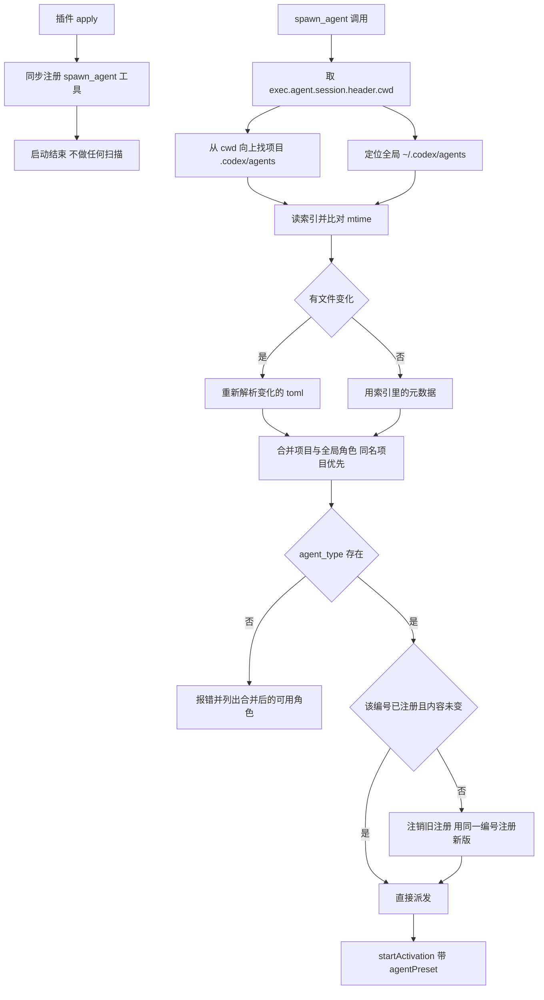

# dsh-codex-agents 执行计划

- 版本：v2
- 日期：2026-10-25
- 状态：待审核
- 上一版：v1（提交 `fe1adf2`），审核结论 `NEEDS_MODIFICATION`

## v2 修改摘要

| 项 | v1 | v2 |
|---|---|---|
| 角色查找 | 找到项目目录就只用项目目录 | 项目与全局按名称合并，同名项目优先；仍能调用全局独有角色 |
| preset 编号 | `agent.name`，冲突时用文件内容哈希 | `dshca_<agentName>_<pathHash5>`，哈希来自目录路径，与文件内容无关 |
| 文件更新 | 不注销，另注册新 id | 注销旧注册，用同一编号注册新版；运行中子代理继续用旧版 |
| 启动扫描 | `warmUp` 遍历全部工作区并预扫描 | 取消启动扫描，首次调用时按需扫描 |
| TOML 依赖 | 装不上就自写简化解析器 | `smol-toml` 作为普通运行时依赖，按正式安装方式验证 |

## 目标

写一个 DSH 插件，暴露与 Codex 同签名的 `spawn_agent` 工具，让同一份 SKILL.md 能在 Codex 和 DSH 两边通用。角色定义直接复用 Codex 的 `.codex/agents/*.toml`，支持项目级与全局两级，DSH 侧通过注册 agent preset 实现人格与工具隔离。

## 成功标准

1. 项目里有 `.codex/agents/*.toml` 时，`spawn_agent(task_name, agent_type, message)` 能起一个带该 toml 人格的子 agent。
2. 不同项目各自用自己的 `.codex/agents/`，同名角色互不干扰。
3. 找不到 `agent_type` 时明确报错并列出可用角色，不静默回退。
4. 启动不被阻塞，UI 不因扫描卡顿。
5. 改 toml 后，下一次调用生效，无需重启。

成功标准 3 的「可用角色」指项目与全局合并后的名单。

## 命名

| 项 | 值 | 说明 |
|---|---|---|
| 包名 | `dsh-codex-agents` | npm 可用，已核实 |
| 工具名 | `spawn_agent` | 与 Codex 一致 |
| preset id | `dshca_<agentName>_<pathHash5>` | 编号只由角色名与目录路径决定，见下文 |

npm 上另三个候选 `dsh-spawn-agent`、`dsh-codex-subagents`、`dsh-codex-agent-bridge` 也可用；`dsh-agent-bridge` 已被占用。

## 已核实的技术前提

| 事实 | 依据 |
|---|---|
| `SubagentStartRequest` 有 `agentPreset` 字段 | `dsh-subagent/lib/index.js`：`composition: { agentPreset: request.agentPreset }` |
| `request.persona` 已从请求移除 | `applyChildOverrides` 读 `composition.persona`，但 `startActivation` 只填 `agentPreset` |
| preset 是设置子 agent 人格与工具集的唯一公开路径 | 同上；非公开路径为 `reserveChildComposition`，`dsh-subagent-registry` 在用 |
| `ctx.agentPresets.register(definition)` 是公开 API，返回 disposer | `dsh-agent-preset-registry/lib/index.js`：`return unregister` |
| `register()` 立即 `activate()` 并建完整插件树 | 同上：`record.ready = this.activate(record)` |
| id 已存在时 `register()` 抛错，不会覆盖 | 同上：`if (this.definitions.has(definition.id)) throw new Error("Duplicate agent preset: ...")` |
| 注销后运行中的子代理仍可用旧版 | 同上：disposer 标记 `retired` 后调 `collect()`，而 `collect()` 在 `generation.users !== 0` 时直接返回 |
| `spawn` provider 支持独立预设 | `dsh-subagent-spawn-in-process/lib/index.js`：`capabilities.agentPreset: true`、`inheritsParentContext: false` |
| `request.prompt` 是 `ContentBlock[]` 而非字符串 | `dsh-tool-subagent` 构造 request 的代码 |
| `defineTool` 来自 `@deepseek-ai/dsh-tools` | `dsh-tool-subagent` 的 import |
| DSH 内置 Node 24.21，无 `node:toml` | 实测 `import('node:toml')` 失败 |

「注销后运行中子代理仍可用旧版」是本版编号策略成立的前提：同一编号注销再注册，新旧两个 generation 并存，正在跑的子代理挂在旧 generation 上，`users` 未归零前不会被销毁。

## 插件结构

```
dsh-codex-agents/
├── package.json          name=dsh-codex-agents, type=module, dsh.bundle.patch
├── cordis.patch.yml      insert 一行，id=dsh-codex-agents
├── tsconfig.json
├── src/
│   ├── index.ts          插件入口、配置 schema、只注册工具
│   ├── toml.ts           TOML 解析 + 字段校验
│   ├── discover.ts       目录发现：项目向上查找 + 全局目录定位
│   ├── roster.ts         项目与全局角色合并、同名优先级
│   ├── index-cache.ts    索引读写、mtime 比对、编号分配结果持久化
│   ├── preset.ts         toml 转 preset definition、按需注册与替换
│   ├── tool.ts           spawn_agent 工具定义与派发
│   └── base-plugins.ts   基础工具清单
└── test/*.test.mjs       node:test 单元测试
```

`roster.ts` 是 v2 新增模块，专门负责合并与优先级，避免 `discover.ts` 同时承担查找和决策两件事。

## 数据流



启动路径只有一步：注册工具。扫描、解析、注册全部推迟到第一次调用。

## 分模块设计

### 1. 目录发现 `discover.ts`

```ts
findProjectAgentsDir(cwd: string, maxDepth: number): { agentsDir: string; projectRoot: string } | undefined
findGlobalAgentsDir(home: string): string | undefined
```

`findProjectAgentsDir` 从 `cwd` 向上逐级查找 `.codex/agents/`，找到最近的返回，同时返回项目根（`agentsDir` 的上两级）。到文件系统根仍未找到返回 `undefined`。`findGlobalAgentsDir` 检查 `~/.codex/agents` 是否存在。

两个函数都只检查目录是否存在，不读内容，不合并结果。合并由 `roster.ts` 负责。

### 2. 角色合并 `roster.ts`

```ts
interface RoleSource {
  agent: CodexAgent
  file: string          // 绝对路径
  hashBase: string      // 算 pathHash5 的路径：项目角色用项目根，全局角色用全局角色目录
  scope: 'project' | 'global'
}

mergeRoster(project: RoleSource[], global: RoleSource[]): RoleSource[]
```

规则：

- 以 `name` 为键合并，项目条目覆盖全局同名条目，全局条目保留位置
- 项目角色目录不存在时，合并结果就是全局角色
- 项目与全局都不存在时返回空数组，由调用方报错
- 合并结果按 `name` 排序，保证报错信息里的角色列表稳定

这是 v1 的行为变化点：v1 找到项目目录就丢弃全局目录，v2 始终两处都看。

### 3. TOML 解析 `toml.ts`

依赖 `smol-toml`，作为普通运行时依赖写进 `dependencies`，由插件正式安装流程装入 profile。

```ts
interface CodexAgent {
  name: string                    // 必填
  description: string             // 必填
  developerInstructions: string   // 必填
  model?: string                  // 读取但忽略
  modelReasoningEffort?: string   // 读取但忽略
  sandboxMode?: string            // 读取但忽略
}
```

校验规则：

- 缺 `name` / `description` / `developer_instructions` 抛错，错误信息含文件路径
- `name` 不匹配 `^[A-Za-z0-9_-]+$` 抛错
- 未知键忽略，与 Codex 行为一致
- 解析失败只影响该文件，不影响同目录其他文件

不设「依赖加载失败就自己写解析器」的分支。若正式安装时 `smol-toml` 确实无法加载，记录实际错误、影响范围和复现步骤，据此修订方案后再实施，不在计划里预留替代实现。

### 4. 索引缓存 `index-cache.ts`

路径：找到项目根时用 `<projectRoot>/.dsh/agents-index.json`；没有项目根（会话目录不在任何项目内）时用 `~/.dsh/agents-index.json`。不存在则创建 `.dsh` 目录。

索引记录的是**该会话可见的合并名单**，不是单个目录的扫描结果：

```json
{
  "version": 2,
  "scannedAt": "2026-10-25T00:00:00.000Z",
  "projectRoot": "/path/to/project",
  "agents": [
    {
      "name": "reviewer",
      "scope": "project",
      "dir": "/path/to/project/.codex/agents",
      "file": "reviewer.toml",
      "mtimeMs": 1761300000000,
      "size": 812,
      "presetId": "dshca_reviewer_81639",
      "error": null
    },
    {
      "name": "implementation_reviewer",
      "scope": "global",
      "dir": "/home/user/.codex/agents",
      "file": "implementation-reviewer.toml",
      "mtimeMs": 1761200000000,
      "size": 640,
      "presetId": "dshca_implementation_reviewer_13368",
      "error": null
    }
  ]
}
```

- 只存元数据，不存 persona 正文；真相始终在 toml 里
- `presetId` 持久化，保证跨进程重启后编号一致，也让冲突后缀稳定
- 读缓存后对每个文件 `stat`，比对 `mtimeMs` 与 `size`，任一变化则重新解析该文件并更新该条目
- 缓存损坏或 `version` 不符则丢弃并全量重扫，不报错
- 文件消失则从索引移除该条目
- `.dsh` 不可写时降级为进程内 Map，记 warn；此时编号冲突后缀只在本进程内稳定

### 5. preset 构建与注册 `preset.ts`

```js
{
  id: presetId,
  name: agent.name,
  description: agent.description,
  plugins: [
    { id: 'persona', name: '@deepseek-ai/dsh-persona',
      config: { prefix: agent.developerInstructions } },
    ...BASE_PLUGINS
  ]
}
```

`BASE_PLUGINS`（`base-plugins.ts`）从 `standard.patch.yml` 摘取，刻意不含 `tool-subagent` / `tool-workflow` / `tool-plugin-manager`，避免子 agent 无限套娃：

| 插件 | 说明 |
|---|---|
| `dsh-agent-instructions` | AGENTS.md 加载，maxBytes 65536 |
| `dsh-time-context` | 时间上下文 |
| `dsh-tool-bash` / `dsh-tool-pwsh` | 按平台 disabled |
| `dsh-tool-fs` | 文件读写 |
| `dsh-tool-fs-search` | 搜索 |
| `dsh-tool-jobs` | 后台任务 |
| `dsh-skill-filesystem` + `dsh-tool-skill` | skill 能力 |
| `dsh-tool-todo` | 待办 |

#### 编号生成

```ts
presetId = `dshca_${agentName}_${pathHash5}`
```

- `pathHash5` 由路径算出：`sha256(path)` 取前 4 字节读作无符号整数，对 `100000` 取余，左补零成 5 位数字
- 项目角色的路径取**项目根目录**（`.codex/agents` 的上两级），全局角色的路径取全局角色目录 `~/.codex/agents`
- 不含文件内容哈希，因此改 toml 不换编号
- 同项目同名角色编号稳定；不同项目同名角色因项目根不同而编号不同

#### 冲突处理

编号可能撞车的两种情况：`pathHash5` 偶然相同（十万分之一），或其他插件已占用同名 id。

1. 先 `await ctx.agentPresets.list()` 查现有 id
2. 目标编号空闲则直接用
3. 被占用且不是本插件为该角色注册的，依次尝试 `<id>_2`、`<id>_3`，直到空闲
4. 分配结果写回索引条目的 `presetId`，下次启动直接复用，不重新试探
5. 不注销、不改动其他插件的预设；冲突时只改自己的编号

#### 注册与替换

- 内存 Map 记录 `presetId -> { file, mtimeMs, size, disposer }`
- 该编号未注册：`register()` 并保存 disposer
- 已注册且 `mtimeMs`、`size` 都没变：直接复用
- 已注册但文件变了：先 `await disposer()` 注销旧注册，再用**同一编号** `register()` 新版
- 替换期间正在运行的子代理挂在旧 generation 上，`users` 未归零前不会被销毁，继续用旧版人格跑完；新调用拿到新版
- 注销与注册之间若有并发调用，用 Promise Map 串行化同一 `presetId` 的操作，避免出现 `agent-preset/not-found`
- 插件卸载时统一调用所有 disposer

编号不变意味着预设下拉框里不会因为改文件而堆积条目。

### 6. `spawn_agent` 工具 `tool.ts`

签名与 Codex 对齐，保持三参数：

```
spawn_agent(
  task_name: string,    // 合法下划线名，传给 label 与日志
  agent_type: string,   // 必须等于 toml 的 name 字段
  message: string       // 自足的任务描述
)
```

`execute` 流程：

1. 取 `exec.agent.session.header.cwd`，缺失则报错
2. `findProjectAgentsDir` 找项目角色目录与项目根；`findGlobalAgentsDir` 找全局目录
3. 读索引，对两处目录的文件做 `stat` 比对，只重新解析变化的文件
4. `mergeRoster` 得到合并名单
5. 名单中找 `name === agent_type`
   - 找不到则抛错：`Unknown agent_type "xxx". Available: a, b, c. (scanned <项目目录>, <全局目录>)`
6. `ensurePresetRegistered` 得到 `presetId`，必要时完成注销与重注册
7. 派发：

```js
await ctx.subagents.startActivation({
  provider: 'spawn',
  label: task_name,
  request: {
    prompt: [{ type: 'text', text: message }],
    parent: exec.agent,
    agentPreset: presetId,
  },
  signal: exec.signal,
  delivery: 'parent',
})
```

8. 返回 `started subagent <childId>`，与官方 `subagent` 工具输出格式一致

首次调用要读 TOML、建插件树，因此比后续调用慢；这是按需扫描的直接代价，接受。

### 7. 插件入口 `index.ts`

```ts
export function apply(ctx, config) {
  ctx.tools.register(spawnAgentTool(ctx, config))
}
```

启动阶段只做一件事：注册工具。没有 `warmUp`，不调 `ctx.workspaceRegistry.list()`，不遍历工作区，不预先解析任何 toml。启动耗时不随角色文件数量增长。

配置 schema（`schemastery`）：

| 字段 | 默认 | 说明 |
|---|---|---|
| `toolName` | `spawn_agent` | 工具名 |
| `provider` | `spawn` | subagent provider |
| `agentsDirName` | `.codex/agents` | 相对项目根 |
| `searchParents` | `true` | 是否向上查找 |
| `maxParentDepth` | `8` | 向上层数上限 |
| `maxDepth` | 继承 Host | 委派深度 |
| `indexFileName` | `.dsh/agents-index.json` | 相对项目根 |

`workspaceRegistry` 相关配置项全部移除，因为不再需要枚举工作区。

## 边界与失败处理

| 场景 | 行为 |
|---|---|
| 项目无 `.codex/agents/` | 只用全局角色；全局也没有则调用报错 |
| 项目与全局都有同名角色 | 项目优先；全局该名字条目不生效，不报错 |
| 全局独有角色 | 项目存在角色目录时仍可调用 |
| toml 缺必填字段 | 该条目不进合并名单，索引记 `error`；调用时报错含原因 |
| toml 解析失败 | 同上，不影响同目录其他文件 |
| `agent_type` 不匹配任何 name | 报错并列出合并后的可用角色 |
| preset 注册失败 | 报错含 preset 诊断，不静默回退到无 preset |
| 编号被其他插件占用 | 追加 `_2`、`_3`，不覆盖对方预设 |
| 两个项目同名角色 | 路径不同，编号不同，各自索引独立 |
| 文件更新 | 注销旧注册后同编号重注册；运行中子代理用旧版跑完 |
| 并发调用同一 agent | Promise Map 串行化，避免注销注册竞态 |
| `.dsh` 目录不可写 | 索引降级为进程内 Map，记 warn |
| 项目根找不到 | 索引写到 `~/.dsh/agents-index.json` |
| 会话缺少 `cwd` | 调用报错，提示无法定位项目目录 |

## 测试

用 `node:test`，只测纯函数，不依赖 DSH 运行时：

| 测试文件 | 覆盖 |
|---|---|
| `toml.test.mjs` | 正常解析、缺字段、非法 name、未知键忽略、多行字符串、`"""` 嵌套 |
| `discover.test.mjs` | 向上查找、深度上限、返回项目根、全局目录不存在 |
| `roster.test.mjs` | 项目覆盖全局、全局独有保留、两边都空、排序稳定 |
| `index-cache.test.mjs` | 写入读取、mtime 与 size 失效、损坏丢弃、文件消失、编号持久化 |
| `preset.test.mjs` | 编号格式、`pathHash5` 位数与稳定性、内容变化编号不变、冲突后缀递增、替换时先注销 |

`preset.test.mjs` 的注册相关断言用假 registry 注入，不启动真实 DSH。

不写集成测试（需真实 DSH 运行时，代价高）。集成验证靠手动。

## 验收步骤

1. 插件装进 `desktop` profile（GUI 安装，CLI 被锁），确认 `smol-toml` 随依赖装入
2. 重启 DSH
3. 在项目里放 `.codex/agents/` 测试 toml，同时在 `~/.codex/agents/` 放一个全局角色
4. 新开会话，让模型调用 `spawn_agent(task_name: "t1", agent_type: "<项目角色名>", message: "...")`
5. 问子 agent「你的职责是什么」，确认应答出 toml 里的内容
6. 同一会话调用全局独有角色，确认也能起子 agent
7. 确认 `.dsh/agents-index.json` 已生成，且含项目与全局两条
8. 改 toml 后再次调用，确认新内容生效，且预设下拉框没有多出条目
9. 另开一个项目放同名角色，确认两个项目各自生效、编号不同

## 已知限制（第一版接受）

1. preset 注册后出现在预设下拉框，所有项目可见；属观感问题，不影响功能
2. `model` / `model_reasoning_effort` 忽略，子 agent 继承调用者模型
3. `sandbox_mode` 忽略，不强制只读；与 Codex 行为一致，Codex 本身也不强制
4. `mcp_servers` / `skills.config` 忽略
5. 首次调用某 agent 会慢几百毫秒，因需读 TOML 并建插件树
6. 不做文件监听，靠调用时比对 `mtimeMs` 与 `size`
7. DSH 进程重启后，旧子代理不恢复，也不保留历史预设；跨重启恢复推迟到后续版本
8. 不给子代理施加额外的工具权限限制；工具集由 `BASE_PLUGINS` 决定，权限收紧推迟到后续版本
9. `pathHash5` 只保证同机稳定；换机器或换用户目录后编号会变

## 待确认的假设

1. `smol-toml` 作为普通运行时依赖能被插件正式安装流程装入 profile：步骤 1 验证。失败时记录实际错误后修订方案，不自写解析器。
2. 开发目录位置：当前会话工作区之外写文件需要授权。建议先在 `default-workspace/dsh-codex-agents/` 开发。

v1 的第 2 条假设（`ctx.workspaceRegistry` 可见性）随启动扫描一起取消，不再需要。

## 实施顺序

1. 项目骨架与 `smol-toml` 依赖验证
2. `toml.ts` 与测试
3. `discover.ts` 与测试
4. `roster.ts` 与测试
5. `index-cache.ts` 与测试
6. `preset.ts` 与 `base-plugins.ts` 与测试
7. `tool.ts`
8. `index.ts`（只注册工具）
9. 构建与手动集成验证
