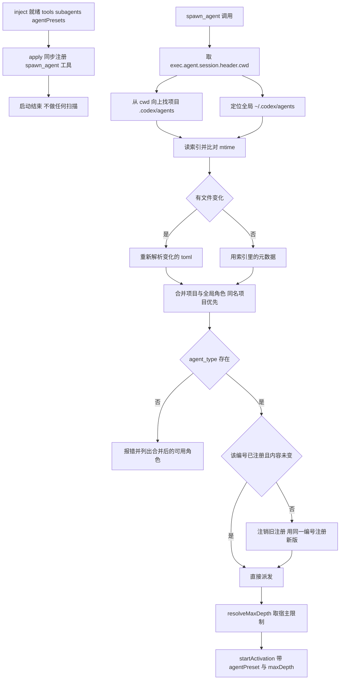

# dsh-codex-agents 执行计划

- 版本：v6
- 日期：2026-10-25
- 状态：待审核
- 上一版：v5（提交 `a36086a`），审核意见：`schemastery` 应放 `dependencies`
- 目标 DSH 版本：`@deepseek-ai/dsh-desktop-runtime` `0.2.1-rc.3`

## v6 修改摘要

| 项 | v5 | v6 |
|---|---|---|
| `schemastery` 依赖层级 | 放在 `devDependencies`，靠宿主间接提供 | 移到 `dependencies`，由插件自己的依赖声明保证运行期可加载 |
| 依赖分层理由 | 按「宿主包与非宿主包」划分 | 按「运行期是否 import」划分：运行期用到的库放 `dependencies`，共享服务放 `peerDependencies`，仅编译期用放 `devDependencies` |

v5 的两处修订（子 agent 可再委派、独立 `DSH_HOME` 验收环境），v4 的构建配置与三层依赖声明，v3 的四处修订（`maxDepth` 传递、`inject` 声明、包入口与构建先后、目标运行版本），v2 的五处修订（角色合并、路径编号、同编号重注册、按需扫描、`smol-toml` 依赖）全部保留，见下文各节。

## 目标

写一个 DSH 插件，暴露与 Codex 同签名的 `spawn_agent` 工具，让同一份 SKILL.md 能在 Codex 和 DSH 两边通用。角色定义直接复用 Codex 的 `.codex/agents/*.toml`，支持项目级与全局两级，DSH 侧通过注册 agent preset 实现人格与工具隔离。

## 成功标准

1. 项目里有 `.codex/agents/*.toml` 时，`spawn_agent(task_name, agent_type, message)` 能起一个带该 toml 人格的子 agent。
2. 不同项目各自用自己的 `.codex/agents/`，同名角色互不干扰。
3. 找不到 `agent_type` 时明确报错并列出可用角色，不静默回退。
4. 启动不被阻塞，UI 不因扫描卡顿。
5. 改 toml 后，下一次调用生效，无需重启。

成功标准 3 的「可用角色」指项目与全局合并后的名单。

## 命名

| 项 | 值 | 说明 |
|---|---|---|
| 包名 | `dsh-codex-agents` | npm 可用，已核实 |
| 工具名 | `spawn_agent` | 与 Codex 一致 |
| preset id | `dshca_<agentName>_<pathHash5>` | 编号只由角色名与目录路径决定，见下文 |

npm 上另三个候选 `dsh-spawn-agent`、`dsh-codex-subagents`、`dsh-codex-agent-bridge` 也可用；`dsh-agent-bridge` 已被占用。

## 已核实的技术前提

目标运行版本：`@deepseek-ai/dsh-desktop-runtime` `0.2.1-rc.3`（本机 `/Applications/DeepSeek Harness.app` 内置）。下表所列包均在该运行时内核实，版本同为 `0.2.1-rc.3`：`@deepseek-ai/dsh-agent-preset-registry`、`@deepseek-ai/dsh-subagent`、`@deepseek-ai/dsh-tool-subagent`、`@deepseek-ai/dsh-subagent-spawn-in-process`。依据一栏写的是这些包内的 `lib/index.js`；升级 DSH 后需按新版本复核标注「关键」的条目。

| 事实 | 依据 |
|---|---|
| **关键** `SubagentStartRequest` 有 `agentPreset` 字段 | `dsh-subagent/lib/index.js`：`composition: { agentPreset: request.agentPreset }` |
| `request.persona` 已从请求移除 | `applyChildOverrides` 读 `composition.persona`，但 `startActivation` 只填 `agentPreset` |
| preset 是设置子 agent 人格与工具集的唯一公开路径 | 同上；非公开路径为 `reserveChildComposition`，`dsh-subagent-registry` 在用 |
| **关键** `ctx.agentPresets.register(definition)` 是公开 API，返回 disposer | `dsh-agent-preset-registry/lib/index.js`：`return unregister` |
| `register()` 立即 `activate()` 并建完整插件树 | 同上：`record.ready = this.activate(record)` |
| id 已存在时 `register()` 抛错，不会覆盖 | 同上：`if (this.definitions.has(definition.id)) throw new Error("Duplicate agent preset: ...")` |
| **关键** 注销后运行中的子代理仍可用旧版 | 同上：disposer 标记 `retired` 后调 `collect()`，而 `collect()` 在 `generation.users !== 0` 时直接返回 |
| **关键** `spawn` provider 支持独立预设与深度限制 | `dsh-subagent-spawn-in-process/lib/index.js`：`capabilities` 中 `agentOptions`、`agentPreset`、`outputSchema`、`depthLimit` 全为 `true`；`inheritsParentContext: false` |
| **关键** 深度限制需由调用方放进请求 | `dsh-tool-subagent/lib/index.js`：`const maxDepth = runtimeCtx.subagents.resolveMaxDepth(config.maxDepth)`，随后 `...maxDepth !== void 0 ? { maxDepth } : {}` 拼进 `request` |
| `resolveMaxDepth(configured)` 的取值规则 | `dsh-subagent/lib/index.js`：传 `"provider-managed"` 返回 `undefined`，传数字返回该数字，未传则读宿主配置 `maxDepth`（默认 `1`） |
| 请求带 `maxDepth` 要求 provider 有 `depthLimit` | `dsh-subagent/lib/index.js`：`when: request.maxDepth !== void 0, cap: "depthLimit"`，缺失时抛 `UNSUPPORTED_CAPABILITY` |
| 子代理深度按父深度加一计算并校验上限 | 同上：`resolveChildDepth` 里 `childDepth = delegationDepthOf(parent) + 1`，超过 `maxDepth` 抛 `SubagentDepthError` |
| **关键** 插件用 `inject` 声明必需服务 | `dsh-tool-todo/lib/index.js`：`const inject = ["tools", "sessionProjections"]`，与 `name`、`apply` 一起具名导出 |
| 服务未就绪时插件不应直接取用 | `cordis-plugin-development/references/practices.md`：把服务放进 `inject` 或 `ctx.inject([...], ...)`，否则在不含该服务的配置里会抛错 |
| `request.prompt` 是 `ContentBlock[]` 而非字符串 | `dsh-tool-subagent` 构造 request 的代码 |
| `defineTool` 来自 `@deepseek-ai/dsh-tools` | `dsh-tool-subagent` 的 import |
| 宿主包在 npm 上可安装，版本与内置运行时一致 | `npm view @deepseek-ai/dsh-tools versions` 末项为 `0.2.1-rc.3`；`@deepseek-ai/cordis@4.0.5`、`@deepseek-ai/schemastery@3.18.5`、`@deepseek-ai/dsh-agent-preset-registry@0.2.1-rc.3` 均存在 |
| 宿主包之间用 peer 声明，不各自复制实例 | 已安装插件 `dsh-workspace-mcp`、`dsh-opencode-go` 的 `peerDependencies` 写 `@deepseek-ai/cordis` 与 `@deepseek-ai/dsh-*`，只在 `devDependencies` 里锁具体版本 |
| `dsh-tool-subagent` 把 `schemastery` 放在 `dependencies` | `npm view @deepseek-ai/dsh-tool-subagent@0.2.1-rc.3 dependencies`：`@deepseek-ai/schemastery ~3.18.5`、`zod 4.4.3` |
| 已装插件对 `schemastery` 的层级取决于运行期是否引用 | `dsh-subagent-codex` 运行期引用，放 `dependencies`（`~3.18.5`）；`dsh-workspace-mcp` 的 `lib/index.js` 中 `schemastery` 出现 0 次，放 `devDependencies`（`^3.18.5`） |
| DSH 内置 Node 24.21，无 `node:toml` | 实测 `import('node:toml')` 失败 |

「注销后运行中子代理仍可用旧版」是本版编号策略成立的前提：同一编号注销再注册，新旧两个 generation 并存，正在跑的子代理挂在旧 generation 上，`users` 未归零前不会被销毁。

## 插件结构

```
dsh-codex-agents/
├── package.json          name=dsh-codex-agents, type=module, exports, files, dsh.bundle.patch
├── cordis.patch.yml      insert 一行，id=dsh-codex-agents
├── tsconfig.json         唯一的编译配置，构建与类型检查共用
├── locale/
│   ├── en.json           meta.title / meta.description
│   └── zh.json
├── icon.svg
├── src/                  TypeScript 源码
│   ├── index.ts          插件入口、配置 schema、服务声明、只注册工具
│   ├── toml.ts           TOML 解析 + 字段校验
│   ├── discover.ts       目录发现：项目向上查找 + 全局目录定位
│   ├── roster.ts         项目与全局角色合并、同名优先级
│   ├── index-cache.ts    索引读写、mtime 比对、编号分配结果持久化
│   ├── preset.ts         toml 转 preset definition、按需注册与替换
│   ├── tool.ts           spawn_agent 工具定义与派发
│   └── base-plugins.ts   基础工具清单含本插件，给子 agent 再委派能力
├── lib/                  构建产物，随包发布
│   ├── index.js          ESM 入口
│   └── index.d.ts        入口类型声明
└── test/*.test.mjs       node:test 单元测试，跑在 lib 的构建产物上
```

`roster.ts` 专门负责合并与优先级，避免 `discover.ts` 同时承担查找和决策两件事。编译配置只有一个 `tsconfig.json`，`build`、`typecheck` 两个脚本都指向它，不再出现第二份配置文件名。

### 可安装包格式

`package.json` 必须让 DSH 的加载器找得到运行入口，并声明编译所需的工具与宿主依赖：

```json
{
  "name": "dsh-codex-agents",
  "version": "0.1.0",
  "type": "module",
  "main": "./lib/index.js",
  "types": "./lib/index.d.ts",
  "exports": {
    ".": { "types": "./lib/index.d.ts", "default": "./lib/index.js" },
    "./package.json": "./package.json",
    "./locale/*.json": "./locale/*.json",
    "./icon": "./icon.svg"
  },
  "dsh": { "bundle": { "patch": "./cordis.patch.yml" } },
  "files": ["lib/**/*.js", "lib/**/*.d.ts", "cordis.patch.yml",
            "locale/*.json", "icon.svg", "README.md", "LICENSE"],
  "dependencies": {
    "@deepseek-ai/schemastery": "3.18.5",
    "smol-toml": "^1.9.1"
  },
  "peerDependencies": {
    "@deepseek-ai/cordis": ">=4.0.5 <5",
    "@deepseek-ai/dsh-tools": ">=0.2.1-rc.3 <0.3.0",
    "@deepseek-ai/dsh-subagent": ">=0.2.1-rc.3 <0.3.0",
    "@deepseek-ai/dsh-agent-preset-registry": ">=0.2.1-rc.3 <0.3.0"
  },
  "devDependencies": {
    "@deepseek-ai/cordis": "4.0.5",
    "@deepseek-ai/dsh-tools": "0.2.1-rc.3",
    "@deepseek-ai/dsh-subagent": "0.2.1-rc.3",
    "@deepseek-ai/dsh-agent-preset-registry": "0.2.1-rc.3",
    "@types/node": "^22.20.0",
    "typescript": "^5.9.3"
  },
  "scripts": {
    "build": "tsc -p tsconfig.json",
    "typecheck": "tsc -p tsconfig.json --noEmit",
    "test": "npm run build && node --test test/*.test.mjs",
    "prepack": "npm run build"
  }
}
```

依赖分三层，各管一件事：

| 层 | 内容 | 理由 |
|---|---|---|
| `dependencies` | `@deepseek-ai/schemastery`、`smol-toml` | 插件在运行期自己 import 的库：`schemastery` 用于构造并导出 `Config`，`smol-toml` 用于解析角色文件。二者不共享宿主服务实例，必须由插件自己的依赖声明保证可加载 |
| `peerDependencies` | `@deepseek-ai/cordis`、`dsh-tools`、`dsh-subagent`、`dsh-agent-preset-registry` | 这些是宿主提供的服务与共享实例，插件必须复用宿主那一份，不能自带副本 |
| `devDependencies` | 上表四个宿主包的具体版本、`@types/node`、`typescript` | 只用于编译与类型检查；宿主包在此锁定到与目标运行时一致的版本，避免类型漂移 |

peer 的写法照抄工作区里已安装的第三方插件：`@deepseek-ai/cordis` 用 `>=4.0.5 <5` 的大版本区间，宿主包用 `>=0.2.1-rc.3 <0.3.0`。`dsh-tools` 必须在 peer 列，因为 `defineTool` 由它导出，`inject` 里的 `tools` 服务也由它提供。

`schemastery` 放 `dependencies` 而不是 `devDependencies`，判断依据是运行期是否 import 它。插件入口要 `export const Config = z.object({...})`，模块加载时就会求值，属于运行期依赖；若只放 dev，正式安装后靠宿主间接提供，插件自己的声明并不保证它存在。同一运行时里的 `dsh-tool-subagent` 与 `dsh-subagent-codex` 都把 `schemastery` 放在 `dependencies`（`~3.18.5`），而 `dsh-workspace-mcp` 放 `devDependencies` 是因为它的运行入口里完全没有引用（`grep -c schemastery lib/index.js` 为 0），只在构建期使用。本插件属于前一种。

### 编译配置 `tsconfig.json`

```json
{
  "compilerOptions": {
    "target": "ES2023",
    "lib": ["ES2023"],
    "module": "NodeNext",
    "moduleResolution": "NodeNext",
    "rootDir": "src",
    "outDir": "lib",
    "declaration": true,
    "declarationMap": false,
    "sourceMap": false,
    "strict": true,
    "skipLibCheck": true,
    "types": ["node"],
    "verbatimModuleSyntax": true,
    "noEmitOnError": true
  },
  "include": ["src/**/*.ts"],
  "exclude": ["lib", "test", "node_modules"]
}
```

要点：

- `rootDir: src`、`outDir: lib` 保证产出的相对路径就是 `lib/index.js` 与 `lib/index.d.ts`，与 `main`、`types`、`exports` 完全对齐
- `declaration: true` 才会生成 `lib/index.d.ts`；`exports["."].types` 指向它，缺这个文件类型解析会失败
- `module`／`moduleResolution` 用 `NodeNext`，与 `"type": "module"` 的 ESM 输出一致，避免生成 CommonJS 后加载器按 ESM 读取失败
- `types: ["node"]` 只需 Node 类型；不引入 DOM，防止误用浏览器 API
- `noEmitOnError: true` 保证类型错误时不产出半成品入口

约定：

- `exports["."]` 指向 `lib/index.js`，`main`、`types` 与之对应，三者都不可指向 `src/`
- `dsh.bundle.patch` 指向根目录的 `cordis.patch.yml`
- `files` 覆盖运行所需全部文件：构建产物、补丁、locale、图标；`prepack` 保证打包前一定有产物
- `locale/en.json` 与 `locale/zh.json` 提供 `meta.title`、`meta.description`，`icon.svg` 为包内相对路径
- 构建器不指定，`tsc` 只是其中一种；若换构建器，须继续保证 `lib/index.js` 与 `lib/index.d.ts` 两个产物存在，并保留 `typescript` 之外的依赖声明不变

构建产物与安装验证的先后：先有 `lib/index.js`，再谈正式安装。`npm pack` 出的包必须包含 `lib/index.js` 与 `lib/index.d.ts`，否则安装后加载器没有可执行入口，或类型解析失败。

## 数据流



启动路径只有一步：注册工具。扫描、解析、注册全部推迟到第一次调用。

## 分模块设计

### 1. 目录发现 `discover.ts`

```ts
findProjectAgentsDir(cwd: string, maxDepth: number): { agentsDir: string; projectRoot: string } | undefined
findGlobalAgentsDir(home: string): string | undefined
```

`findProjectAgentsDir` 从 `cwd` 向上逐级查找 `.codex/agents/`，找到最近的返回，同时返回项目根（`agentsDir` 的上两级）。到文件系统根仍未找到返回 `undefined`。`findGlobalAgentsDir` 检查 `~/.codex/agents` 是否存在。

两个函数都只检查目录是否存在，不读内容，不合并结果。合并由 `roster.ts` 负责。

### 2. 角色合并 `roster.ts`

```ts
interface RoleSource {
  agent: CodexAgent
  file: string          // 绝对路径
  hashBase: string      // 算 pathHash5 的路径：项目角色用项目根，全局角色用全局角色目录
  scope: 'project' | 'global'
}

mergeRoster(project: RoleSource[], global: RoleSource[]): RoleSource[]
```

规则：

- 以 `name` 为键合并，项目条目覆盖全局同名条目，全局条目保留位置
- 项目角色目录不存在时，合并结果就是全局角色
- 项目与全局都不存在时返回空数组，由调用方报错
- 合并结果按 `name` 排序，保证报错信息里的角色列表稳定

这是相对 v1 的行为变化：v1 找到项目目录就丢弃全局目录，现在始终两处都看。

### 3. TOML 解析 `toml.ts`

依赖 `smol-toml`，作为普通运行时依赖写进 `dependencies`，由插件正式安装流程装入 profile。

```ts
interface CodexAgent {
  name: string                    // 必填
  description: string             // 必填
  developerInstructions: string   // 必填
  model?: string                  // 读取但忽略
  modelReasoningEffort?: string   // 读取但忽略
  sandboxMode?: string            // 读取但忽略
}
```

校验规则：

- 缺 `name` / `description` / `developer_instructions` 抛错，错误信息含文件路径
- `name` 不匹配 `^[A-Za-z0-9_-]+$` 抛错
- 未知键忽略，与 Codex 行为一致
- 解析失败只影响该文件，不影响同目录其他文件

不设「依赖加载失败就自己写解析器」的分支。若正式安装时 `smol-toml` 确实无法加载，记录实际错误、影响范围和复现步骤，据此修订方案后再实施，不在计划里预留替代实现。

### 4. 索引缓存 `index-cache.ts`

路径：找到项目根时用 `<projectRoot>/.dsh/agents-index.json`；没有项目根（会话目录不在任何项目内）时用 `~/.dsh/agents-index.json`。不存在则创建 `.dsh` 目录。

索引记录的是**该会话可见的合并名单**，不是单个目录的扫描结果：

```json
{
  "version": 2,
  "scannedAt": "2026-10-25T00:00:00.000Z",
  "projectRoot": "/path/to/project",
  "agents": [
    {
      "name": "reviewer",
      "scope": "project",
      "dir": "/path/to/project/.codex/agents",
      "file": "reviewer.toml",
      "mtimeMs": 1761300000000,
      "size": 812,
      "presetId": "dshca_reviewer_81639",
      "error": null
    },
    {
      "name": "implementation_reviewer",
      "scope": "global",
      "dir": "/home/user/.codex/agents",
      "file": "implementation-reviewer.toml",
      "mtimeMs": 1761200000000,
      "size": 640,
      "presetId": "dshca_implementation_reviewer_13368",
      "error": null
    }
  ]
}
```

- 只存元数据，不存 persona 正文；真相始终在 toml 里
- `presetId` 持久化，保证跨进程重启后编号一致，也让冲突后缀稳定
- 读缓存后对每个文件 `stat`，比对 `mtimeMs` 与 `size`，任一变化则重新解析该文件并更新该条目
- 缓存损坏或 `version` 不符则丢弃并全量重扫，不报错
- 文件消失则从索引移除该条目
- `.dsh` 不可写时降级为进程内 Map，记 warn；此时编号冲突后缀只在本进程内稳定

### 5. preset 构建与注册 `preset.ts`

```js
{
  id: presetId,
  name: agent.name,
  description: agent.description,
  plugins: [
    { id: 'persona', name: '@deepseek-ai/dsh-persona',
      config: { prefix: agent.developerInstructions } },
    ...BASE_PLUGINS
  ]
}
```

`BASE_PLUGINS`（`base-plugins.ts`）从 `standard.patch.yml` 摘取，不含 `tool-workflow` / `tool-plugin-manager`，但**必须含本插件自己的 `spawn_agent`**，让子 agent 能继续委派：

| 插件 | 说明 |
|---|---|
| `dsh-agent-instructions` | AGENTS.md 加载，maxBytes 65536 |
| `dsh-time-context` | 时间上下文 |
| `dsh-tool-bash` / `dsh-tool-pwsh` | 按平台 disabled |
| `dsh-tool-fs` | 文件读写 |
| `dsh-tool-fs-search` | 搜索 |
| `dsh-tool-jobs` | 后台任务 |
| `dsh-skill-filesystem` + `dsh-tool-skill` | skill 能力 |
| `dsh-tool-todo` | 待办 |
| `dsh-codex-agents` | 本插件，给子 agent 同一套 `spawn_agent` |

给子 agent 挂本插件时：

- 引用写法与宿主一致，预设树按配置档的 `baseUrl` 解析行名，写包名 `dsh-codex-agents` 即可，与 `cordis.patch.yml` 里 `insert` 的写法相同；包名不带 scope，解析时按配置档目录查找，与 `@deepseek-ai/dsh-persona` 这类带 scope 的写法并存不冲突
- 必须把父请求里实际生效的 `maxDepth` 原样传给子预设，不能省，也不能减一：`resolveChildDepth` 用的是绝对层数（`delegationDepthOf(parent) + 1` 与同一个上限比大小），减一会在正常层数就提前抛 `SubagentDepthError`
- 父请求里没有 `maxDepth`（宿主未配置）时，子预设也不传：子 agent 内本插件再调 `resolveMaxDepth(config.maxDepth)` 时读的是同一个 `subagents` 服务配置，宿主默认值是 `1`，因此全链路仍然共用同一个上限，不会因为少传而放开
- 子 agent 的 `inject` 三项同样需要就绪，`tools` / `subagents` / `agentPresets` 在预设作用域内由宿主提供，不需要额外声明
- 加一层就多一次插件树构建，首次调用延迟随之增加；这是可再委派的代价，第一版接受

不加 `tool-subagent` 的理由是签名与 `spawn_agent` 不一致（它接 `prompt: ContentBlock[]` 且默认工具名 `subagent`），混用会让同一份 SKILL.md 在 DSH 侧失效。只用本插件，工具名与参数才与 Codex 完全一致。

不用 `tool-workflow` / `tool-plugin-manager` 的理由与 v4 相同：两者都能绕开 `maxDepth` 单独发起执行，属于本版不打算开放的入口。

#### 编号生成

```ts
presetId = `dshca_${agentName}_${pathHash5}`
```

- `pathHash5` 由路径算出：`sha256(path)` 取前 4 字节读作无符号整数，对 `100000` 取余，左补零成 5 位数字
- 项目角色的路径取**项目根目录**（`.codex/agents` 的上两级），全局角色的路径取全局角色目录 `~/.codex/agents`
- 不含文件内容哈希，因此改 toml 不换编号
- 同项目同名角色编号稳定；不同项目同名角色因项目根不同而编号不同

#### 冲突处理

编号可能撞车的两种情况：`pathHash5` 偶然相同（十万分之一），或其他插件已占用同名 id。

1. 先 `await ctx.agentPresets.list()` 查现有 id
2. 目标编号空闲则直接用
3. 被占用且不是本插件为该角色注册的，依次尝试 `<id>_2`、`<id>_3`，直到空闲
4. 分配结果写回索引条目的 `presetId`，下次启动直接复用，不重新试探
5. 不注销、不改动其他插件的预设；冲突时只改自己的编号

#### 注册与替换

- 内存 Map 记录 `presetId -> { file, mtimeMs, size, disposer }`
- 该编号未注册：`register()` 并保存 disposer
- 已注册且 `mtimeMs`、`size` 都没变：直接复用
- 已注册但文件变了：先 `await disposer()` 注销旧注册，再用**同一编号** `register()` 新版
- 替换期间正在运行的子代理挂在旧 generation 上，`users` 未归零前不会被销毁，继续用旧版人格跑完；新调用拿到新版
- 注销与注册之间若有并发调用，用 Promise Map 串行化同一 `presetId` 的操作，避免出现 `agent-preset/not-found`
- 插件卸载时统一调用所有 disposer

编号不变意味着预设下拉框里不会因为改文件而堆积条目。

### 6. `spawn_agent` 工具 `tool.ts`

签名与 Codex 对齐，保持三参数：

```
spawn_agent(
  task_name: string,    // 合法下划线名，传给 label 与日志
  agent_type: string,   // 必须等于 toml 的 name 字段
  message: string       // 自足的任务描述
)
```

`execute` 流程：

1. 取 `exec.agent.session.header.cwd`，缺失则报错
2. `findProjectAgentsDir` 找项目角色目录与项目根；`findGlobalAgentsDir` 找全局目录
3. 读索引，对两处目录的文件做 `stat` 比对，只重新解析变化的文件
4. `mergeRoster` 得到合并名单
5. 名单中找 `name === agent_type`
   - 找不到则抛错：`Unknown agent_type "xxx". Available: a, b, c. (scanned <项目目录>, <全局目录>)`
6. `ensurePresetRegistered` 得到 `presetId`，必要时完成注销与重注册
7. 取深度限制：`const maxDepth = ctx.subagents.resolveMaxDepth(config.maxDepth)`
8. 派发：

```js
await ctx.subagents.startActivation({
  provider: 'spawn',
  label: task_name,
  request: {
    prompt: [{ type: 'text', text: message }],
    parent: exec.agent,
    agentPreset: presetId,
    ...maxDepth !== void 0 ? { maxDepth } : {},
  },
  signal: exec.signal,
  delivery: 'parent',
})
```

9. 返回 `started subagent <childId>`，与官方 `subagent` 工具输出格式一致

第 7 步与原生 `subagent` 工具写法一致：由 `resolveMaxDepth` 决定取哪个上限，值不为 `undefined` 才放进请求。这样省略配置时子代理仍受宿主 `maxDepth` 约束，不会绕过宿主委派深度上限；配置成 `'provider-managed'` 时才由 provider 自行处理，但 `spawn` provider 有 `depthLimit` 能力，第一版不支持该取值，配置校验里直接拒绝。

首次调用要读 TOML、建插件树，因此比后续调用慢；这是按需扫描的直接代价，接受。

### 7. 插件入口 `index.ts`

```ts
export const name = 'dsh-codex-agents'
export const inject = ['tools', 'subagents', 'agentPresets']
export const Config = /* schemastery schema */

export function apply(ctx, config) {
  ctx.tools.register(spawnAgentTool(ctx, config))
}
```

`inject` 声明三项必需服务：`tools` 用于注册工具，`subagents` 用于取深度限制与派发，`agentPresets` 用于按需注册预设。这三项在 `apply` 之前就绪，不能靠加载顺序碰运气；声明之后插件在不含它们的配置里会保持未激活，而不是在 `apply` 里抛 `undefined`。

启动阶段只做一件事：注册工具。没有 `warmUp`，不调 `ctx.workspaceRegistry.list()`，不遍历工作区，不预先解析任何 toml。启动耗时不随角色文件数量增长。

配置 schema（`schemastery`）：

| 字段 | 默认 | 说明 |
|---|---|---|
| `toolName` | `spawn_agent` | 工具名 |
| `provider` | `spawn` | subagent provider |
| `agentsDirName` | `.codex/agents` | 相对项目根 |
| `searchParents` | `true` | 是否向上查找 |
| `maxParentDepth` | `8` | 向上层数上限 |
| `maxDepth` | 不传，走宿主值 | 传给 `resolveMaxDepth`；只接受非负安全整数，拒绝 `'provider-managed'` |
| `indexFileName` | `.dsh/agents-index.json` | 相对项目根 |

`workspaceRegistry` 相关配置项全部移除，因为不再需要枚举工作区。

## 边界与失败处理

| 场景 | 行为 |
|---|---|
| 项目无 `.codex/agents/` | 只用全局角色；全局也没有则调用报错 |
| 项目与全局都有同名角色 | 项目优先；全局该名字条目不生效，不报错 |
| 全局独有角色 | 项目存在角色目录时仍可调用 |
| toml 缺必填字段 | 该条目不进合并名单，索引记 `error`；调用时报错含原因 |
| toml 解析失败 | 同上，不影响同目录其他文件 |
| `agent_type` 不匹配任何 name | 报错并列出合并后的可用角色 |
| preset 注册失败 | 报错含 preset 诊断，不静默回退到无 preset |
| 编号被其他插件占用 | 追加 `_2`、`_3`，不覆盖对方预设 |
| 两个项目同名角色 | 路径不同，编号不同，各自索引独立 |
| 文件更新 | 注销旧注册后同编号重注册；运行中子代理用旧版跑完 |
| 并发调用同一 agent | Promise Map 串行化，避免注销注册竞态 |
| `.dsh` 目录不可写 | 索引降级为进程内 Map，记 warn |
| 项目根找不到 | 索引写到 `~/.dsh/agents-index.json` |
| 会话缺少 `cwd` | 调用报错，提示无法定位项目目录 |
| 请求的 `maxDepth` 被 provider 拒绝 | 派发前不校验能力，交给 `startActivation` 抛 `UNSUPPORTED_CAPABILITY`；错误原样透出 |
| 深度超过上限 | `startActivation` 抛 `SubagentDepthError`，错误原样透出，不吞掉 |
| 子 agent 内再调 `spawn_agent` | 允许；子 agent 的工具集含本插件，靠 `maxDepth` 约束层数 |
| 子 agent 拿到的是父请求的同一个上限 | 挂子 agent 的预设时传父请求里实际生效的 `maxDepth`，不减一；父请求没有该字段时也不传，回落到宿主配置的同一个值 |

## 测试

用 `node:test`，只测纯函数，不依赖 DSH 运行时：

| 测试文件 | 覆盖 |
|---|---|
| `toml.test.mjs` | 正常解析、缺字段、非法 name、未知键忽略、多行字符串、`"""` 嵌套 |
| `discover.test.mjs` | 向上查找、深度上限、返回项目根、全局目录不存在 |
| `roster.test.mjs` | 项目覆盖全局、全局独有保留、两边都空、排序稳定 |
| `index-cache.test.mjs` | 写入读取、mtime 与 size 失效、损坏丢弃、文件消失、编号持久化 |
| `preset.test.mjs` | 编号格式、`pathHash5` 位数与稳定性、内容变化编号不变、冲突后缀递增、替换时先注销、`plugins` 含本插件的 `spawn_agent` 条目且 `maxDepth` 传显式值 |
| `tool.test.mjs` | `maxDepth` 放进请求、`'provider-managed'` 被配置校验拒绝、未知 `agent_type` 报错含合并名单 |

`preset.test.mjs` 的注册相关断言用假 registry 注入，不启动真实 DSH。

不写集成测试（需真实 DSH 运行时，代价高）。集成验证靠手动。`maxDepth` 传递不单独做单元测试，它由假 `subagents` 的调用参数体现，在 `tool.test.mjs` 里断言请求含 `maxDepth` 且配置为 `'provider-managed'` 时被拒绝。

## 验收步骤

1. `npm install` 后跑 `npm run build` 与 `npm run typecheck` 均通过，`npm pack` 产物含 `lib/index.js`、`lib/index.d.ts`、`cordis.patch.yml`、locale 与图标
2. 建独立 DSH_HOME 与 web 自制配置档（`dsh --profile <名> --from-default-profile web`），用 `dsh plugin --profile <名> add <安装包>` 装入，确认 `smol-toml` 与 `@deepseek-ai/schemastery` 两个运行期依赖随包装入，插件处于已激活而非报错状态
3. 重启该配置档
4. 在项目里放 `.codex/agents/` 测试 toml，同时在 `~/.codex/agents/` 放一个全局角色
5. 新开会话，让模型调用 `spawn_agent(task_name: "t1", agent_type: "<项目角色名>", message: "...")`
6. 问子 agent「你的职责是什么」，确认应答出 toml 里的内容
7. 同一会话调用全局独有角色，确认也能起子 agent
8. 确认 `.dsh/agents-index.json` 已生成，且含项目与全局两条
9. 改 toml 后再次调用，确认新内容生效，且预设下拉框没有多出条目
10. 另开一个项目放同名角色，确认两个项目各自生效、编号不同
11. 在子 agent 内再调 `spawn_agent`，确认它能看到该工具；把宿主 `maxDepth` 调到 `1` 后重试，确认第二次委派被 `SubagentDepthError` 挡住而不是正常放行

验收环境不用 `desktop` 配置档的理由：`desktop` 由 Electron 独占，命令行拒绝操作；共用真实配置档会把索引文件写进用户已有的项目根。`headless` 与 `sdk` 配置档的默认配置没有 `agent-presets` 服务，插件 `inject` 缺项不会激活，因此也不能用。

## 已知限制（第一版接受）

1. preset 注册后出现在预设下拉框，所有项目可见；属观感问题，不影响功能
2. `model` / `model_reasoning_effort` 忽略，子 agent 继承调用者模型
3. `sandbox_mode` 忽略，不强制只读；与 Codex 行为一致，Codex 本身也不强制
4. `mcp_servers` / `skills.config` 忽略
5. 首次调用某 agent 会慢几百毫秒，因需读 TOML 并建插件树
6. 不做文件监听，靠调用时比对 `mtimeMs` 与 `size`
7. DSH 进程重启后，旧子代理不恢复，也不保留历史预设；跨重启恢复推迟到后续版本
8. 子 agent 的工具集与主 agent 同源，都会加载本插件的 `spawn_agent`；层数只靠 `maxDepth` 约束，不做按角色区分工具集，权限收紧推迟到后续版本
9. `pathHash5` 只保证同机稳定；换机器或换用户目录后编号会变
10. 子 agent 再委派时每次都要在预设作用域内重建一层插件树，层数越深首次调用越慢；本版不做预热

## 待确认的假设

1. `smol-toml` 作为普通运行时依赖能被插件正式安装流程装入 profile：实施顺序第 3 步验证。失败时记录实际错误后修订方案，不自写解析器。
2. 开发目录位置：当前会话工作区之外写文件需要授权。建议先在 `default-workspace/dsh-codex-agents/` 开发。

v1 的第 2 条假设（`ctx.workspaceRegistry` 可见性）随启动扫描一起取消，不再需要。

## 实施顺序

1. 项目骨架：`package.json`（`main`／`types`／`exports`／`files`／三层依赖）、`cordis.patch.yml`、`tsconfig.json`、locale、图标，然后 `npm install` 装齐编译依赖
2. 最小可加载入口：`src/index.ts` 先只做 `inject` 声明与空 `apply`，跑通 `npm run build` 得到 `lib/index.js` 与 `lib/index.d.ts`，再跑 `npm run typecheck` 确认无类型错误
3. 打包与正式安装验证：`npm pack` 确认产物含 `lib/index.js` 与 `lib/index.d.ts`，装入独立 DSH_HOME 的 web 自制配置档，确认插件能激活且 `smol-toml` 随依赖装入
4. `toml.ts` 与测试
5. `discover.ts` 与测试
6. `roster.ts` 与测试
7. `index-cache.ts` 与测试
8. `preset.ts` 与 `base-plugins.ts` 与测试
9. `tool.ts`（含 `maxDepth` 传递）
10. `index.ts` 补全：配置 schema、工具注册、服务声明定型
11. 重新构建、重新打包、重新安装，按验收步骤手动验证

第 2、3 步提前，是因为「能不能装、装完能不能加载」属于包格式问题，晚发现会让后面所有验证都失去载体。第 1 步必须先完成 `npm install`，否则第 2 步连 `tsc` 都跑不起来；这也是审核指出的「无法保证编译成功」的直接原因。`smol-toml` 依赖验证放在第 3 步，此时 `package.json` 的 `dependencies` 已定稿。
